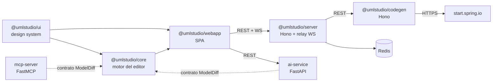
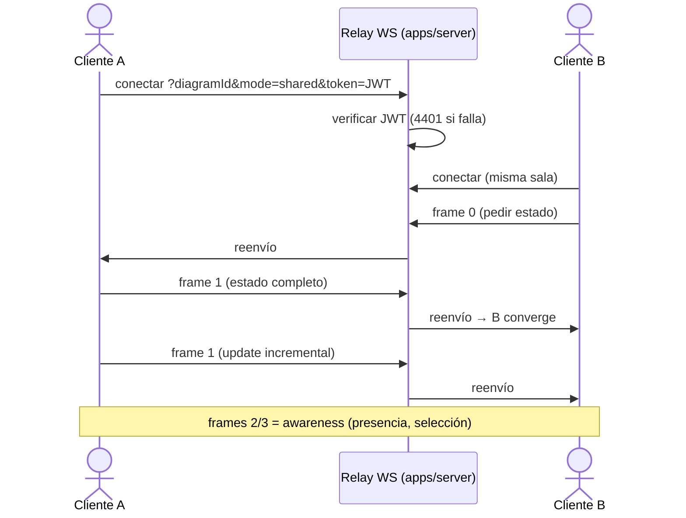

# Arquitectura de Software — UmlStudio

> **Modelo**: vistas 4+1 de Kruchten (PUDS).
> **Versión documentada**: v1.0, cierre del [Ciclo 1](docs/CICLO_1.md).
> **Alcance**: herramienta CASE exclusiva para **diagramas de clases UML 2.5**, colaborativa en tiempo real y asistida por IA.

---

## 1. Vista de casos de uso

Los 14 casos de uso, sus actores (Modelador UML, Cliente MCP Externo) y su especificación están en [`docs/CICLO_1.md`](docs/CICLO_1.md). Estos son los que condicionan la arquitectura:

| CU                                        | Decisión que impone                                              |
| :---------------------------------------- | :--------------------------------------------------------------- |
| CU-02 Colaborar en tiempo real            | CRDT (Yjs) en el cliente + relay WebSocket con JWT               |
| CU-03/CU-04 IA texto, voz e imagen        | Microservicio Python separado con adaptadores intercambiables    |
| CU-06/CU-07 Generar Spring Boot / OpenAPI | Microservicio de generación que consume Spring Initializr        |
| CU-08 Versionado                          | Funciones Lua atómicas en Redis                                  |
| CU-09 MCP                                 | Servidor MCP independiente que reutiliza el contrato `ModelDiff` |

## 2. Vista lógica

### 2.1 Módulos y dependencias



Las líneas punteadas indican que se comparte un **contrato** (el formato `ModelDiff`), no una dependencia de código: los servicios Python lo replican con Pydantic.

### 2.2 Metamodelo (`packages/core/lib/typings.ts`)

```ts
type UMLModel = {
  version: `4.${number}.${number}` // esquema v4
  id: string
  title: string
  type: UMLDiagramType // solo "ClassDiagram"
  nodes: UmlStudioNode[] // tipos: "class", "package"
  edges: UmlStudioEdge[] // relaciones UML
  assessments: Record<string, Assessment>
}
```

- **Nodos**: `package` y `class`. Clase abstracta, interfaz y enumeración son variantes de `class` mediante estereotipo.
- **Relaciones**: `ClassBidirectional`, `ClassUnidirectional`, `ClassAggregation`, `ClassComposition`, `ClassInheritance`, `ClassRealization`, `ClassDependency`. Una asociación puede referenciar una **clase de asociación** (`associationClassNodeId`).
- **Esquema canónico**: `packages/core/schema/uml-model-4.schema.json`, generado desde los tipos (`pnpm --filter @umlstudio/core gen:schema`) y validado con Ajv.

### 2.3 Contrato de mutación `ModelDiff`

Cualquier cambio que no venga de la edición manual (chat de IA, voz, MCP) se expresa como un `ModelDiff` y se valida antes de aplicarse (`packages/core/lib/ai/types.ts`, `diffEngine.ts`):

```ts
type ModelDiff = {
  add?: { elements?: ...; relationships?: ... }
  modify?: { elements?: ...; relationships?: ... }
  remove?: { elementIds?: string[]; relationshipIds?: string[] }
}
```

El mismo contrato existe en Python (Pydantic, `apps/ai-service/src/models/uml.py`). Así, ninguna fuente externa muta el diagrama sin validación.

## 3. Vista de implementación

### 3.1 Monorepo

`pnpm` workspace (`packages/*`, `apps/*`) con versiones centralizadas en el `catalog` de `pnpm-workspace.yaml`. Las apps Python no tienen `package.json` de runtime y quedan fuera del grafo de dependencias de Node.

| Unidad               | Ruta              | Tecnología                                  | Responsabilidad                                                                                            |
| :------------------- | :---------------- | :------------------------------------------ | :--------------------------------------------------------------------------------------------------------- |
| `@umlstudio/core`    | `packages/core`   | React 19, React Flow 12, Yjs, Zustand       | Canvas, nodos y aristas UML, sincronización Yjs, import/export (XMI, SVG, PNG, JSON), contrato `ModelDiff` |
| `@umlstudio/ui`      | `packages/ui`     | Base UI, Tailwind v4, CVA                   | Componentes y tokens de diseño                                                                             |
| `@umlstudio/webapp`  | `apps/webapp`     | Vite, TanStack Router, React Query, Zustand | SPA: rutas, sesión, paneles de IA, versiones, visión                                                       |
| `@umlstudio/server`  | `apps/server`     | Hono, `ws`, node-redis, `jose`, `bcryptjs`  | REST, autenticación, diagramas, versiones, conversión, productividad, relay WebSocket                      |
| `@umlstudio/codegen` | `apps/codegen`    | Hono, TypeScript                            | Spring Boot (Initializr + capas CRUD), SQL, OpenAPI, Postman                                               |
| `ai-service`         | `apps/ai-service` | FastAPI, Pydantic v2, faster-whisper        | Chat → `ModelDiff`, voz, visión, auditoría                                                                 |
| `mcp-server`         | `apps/mcp-server` | FastMCP                                     | Herramientas MCP sobre el modelo                                                                           |
| `docs`               | `apps/docs`       | Docusaurus                                  | Manual de usuario                                                                                          |

### 3.2 Estructura interna relevante

```text
packages/core/lib/   ai/ (ModelDiff, diffEngine) · components/ · edges/ · nodes/classDiagram/
                     export/ (xmiExport, svgToPng, springBootExport) · store/ · sync/ (ydoc, yjsSync)
apps/server/src/     routes/ (auth, users, diagrams, versions, conversion, codegen, productivity, embed, health)
                     services/ (auth-service, autoVersion, productivity-collector, conversion-service…)
                     http/ (app, middleware) · ws.ts · redis.ts · config.ts · auth/ · workers/
apps/webapp/src/     routes/ · pages/ · components/{agentic,auth,home,modals,navbar,versioning,vision}
                     services/ (aiService, DiagramApiClient, WebSocketManager, versionRepository/)
                     stores/ · queries/ · hooks/ · contexts/ · i18n/
apps/ai-service/src/ main.py · adapters/ (auto, ollama, lmstudio, gemini, openrouter, cloudflare)
                     services/ (pipeline, prompting, diff_quality, transcription) · vision/ · models/
apps/codegen/src/    initializr/ · generator/{entity,repository,service,dto,controller,config}/
                     zip/ · sql/ · openapi/ · templates/fallback/
apps/mcp-server/src/ server.py · tools.py · resources.py · transports.py · store.py
```

### 3.3 Reglas por capa

| Capa              | Regla                                                                                                                                                                                                                    |
| :---------------- | :----------------------------------------------------------------------------------------------------------------------------------------------------------------------------------------------------------------------- |
| `apps/server`     | `routes/` solo valida (Zod) y delega; la lógica vive en `services/`; la persistencia, en `redis.ts`. El relay WebSocket exige JWT para salas `shared`                                                                    |
| `apps/webapp`     | Componentes de presentación sin llamadas de red directas; estado síncrono en Zustand (`stores/`), remoto en React Query (`queries/`). La identidad en salas sale de `useAuthStore`; nunca se inventan nombres ni colores |
| `packages/core`   | Agnóstico de la app: no conoce rutas, sesión ni servicios HTTP                                                                                                                                                           |
| `apps/codegen`    | Siempre parte del ZIP oficial de Spring Initializr (respaldo local en `templates/fallback`); genera CRUD en capas `entity`, `repository`, `service`, `dto`, `controller` + `application.yml` (puerto 9000)               |
| `apps/ai-service` | Proveedores detrás de `BaseAIAdapter` (patrón Strategy). Todo diff pasa por `diff_quality.py`. Errores honestos: nunca se inventa una respuesta                                                                          |
| `apps/mcp-server` | Mutaciones solo mediante `ModelDiff`                                                                                                                                                                                     |

## 4. Vista de procesos

### 4.1 Colaboración en tiempo real

El servidor es un **relay**: reenvía los mensajes de una sala al resto de sockets sin interpretar el documento. El estado del diagrama vive en el `Y.Doc` de cada cliente y converge por CRDT.



- **Protocolo** (`packages/core/lib/sync/yjsSync.ts`): `0` pedir estado, `1` update Yjs, `2` pedir awareness, `3` update de awareness. Viajan en base64 dentro de `{ diagramData }`.
- **Presencia**: el servidor mantiene un `Awareness` por sala solo para presencia y productividad, y lo libera cuando la sala se vacía.
- **Persistencia**: el cliente guarda el diagrama por REST (`PUT /api/diagrams/:id`, control optimista con `If-Match`). El servidor crea versiones automáticas periódicas (`autoVersion`).
- **Eventos del servidor**: `publishControl` difunde eventos de control (versión creada/restaurada, diagrama renombrado/eliminado).
- **Límites**: 1 MiB por mensaje, 100 sockets por sala, heartbeat de 30 s.

### 4.2 IA, voz y visión

El navegador llama directamente a `ai-service` (`VITE_AI_SERVICE_URL`):

1. `POST /api/chat` (o `/api/chat/voice`) con prompt y modelo.
2. El adaptador `auto` elige proveedor según `DEFAULT_PROVIDER` (`auto`/`local`/`cloud`) y la complejidad del prompt.
3. `diff_quality.py` valida; se devuelve `{ provider, diff, message }`.
4. La webapp revalida con `validateDiff` y muestra la propuesta antes de aplicarla.

### 4.3 Generación de código

Navegador → `POST /api/codegen/spring-boot` (server) → `apps/codegen` → `start.spring.io/starter.zip` → enriquecimiento del ZIP en memoria → descarga.

### 4.4 Versionado

`commit_snapshot`, `restore_version` y `list_versions_before` son funciones Lua de la librería `umlstudio`, cargadas al arrancar (`FUNCTION LOAD REPLACE`). Garantizan atomicidad sin transacciones del cliente. Detalle en [`docs/DATABASE.md`](docs/DATABASE.md).

## 5. Vista de despliegue

### 5.1 Producción

| Nodo       | Plataforma                               | Contenido                                                                 |
| :--------- | :--------------------------------------- | :------------------------------------------------------------------------ |
| Frontend   | Cloudflare Pages (`umlstudio.pages.dev`) | SPA estática                                                              |
| Backend    | Render (`umlstudio-server`)              | REST + WebSocket en el mismo puerto (`/ws`)                               |
| IA         | Render (`umlstudio-ai-service`)          | FastAPI + Whisper `base` int8 en la imagen                                |
| Codegen    | Render (`umlstudio-codegen`)             | Generador Spring Boot                                                     |
| Redis      | Render Key Value (Valkey)                | Diagramas, versiones, sesiones                                            |
| PostgreSQL | Neon                                     | Solo para las aplicaciones Spring Boot **generadas**; UmlStudio no lo usa |

Restricciones conocidas: el plan gratuito de Render duerme los servicios (arranque en frío de 30–60 s) y limita la memoria a 512 MB.

### 5.2 Local

`pnpm dev` levanta los servicios de Node y Redis en Docker (`docker/compose.local.db.yml`). `docker-compose.yml` levanta el stack completo (`docker/compose.local.yml`).

| Servicio          | Puerto                                        |
| :---------------- | :-------------------------------------------- |
| webapp (Vite)     | 5173                                          |
| server REST       | 8000                                          |
| server WebSocket  | 4444 (en producción comparte puerto con REST) |
| ai-service        | 8001                                          |
| codegen           | 8002                                          |
| mcp-server (SSE)  | 8003                                          |
| docs (Docusaurus) | 3001                                          |
| Redis             | 6379                                          |

## 6. Decisiones de arquitectura

| Decisión                                        | Motivo                                                     | Costo aceptado                                       |
| :---------------------------------------------- | :--------------------------------------------------------- | :--------------------------------------------------- |
| CRDT Yjs en el cliente + relay simple           | Convergencia sin conflictos y servidor liviano             | El servidor no conoce el estado del diagrama en vivo |
| Redis como única base del sistema               | Baja latencia, TTL nativo, atomicidad con Lua              | Sin consultas relacionales; datos con TTL (120 días) |
| Microservicio de IA en Python                   | Ecosistema de IA/voz; despliegue y escalado independientes | Un servicio más que operar                           |
| Adaptadores de IA intercambiables               | Cambiar de proveedor (nube o local) por configuración      | Calidad variable entre modelos                       |
| Spring Initializr como base del código generado | Proyectos que compilan con el andamiaje oficial            | Dependencia externa (mitigada con plantilla local)   |
| Contrato `ModelDiff` común                      | Una sola validación para IA, voz y MCP                     | Mantener los tipos TS y Pydantic alineados           |
