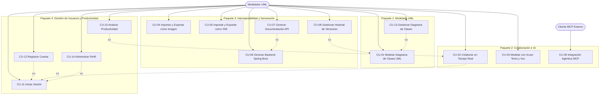

# Ciclo 1 — UmlStudio v1.0 (Primer Parcial)

> **Metodología**: PUDS (Proceso Unificado de Desarrollo de Software).
> **Alcance del ciclo**: todo el producto entregado en el primer parcial: los 14 casos de uso (CU-01 a CU-14).
> **Periodo**: desde el 2026-09-07 (primer commit) hasta la evaluación del primer parcial.
> **Trazabilidad**: requisitos en [`REQUIREMENTS.md`](REQUIREMENTS.md), arquitectura en [`../ARCHITECTURE.md`](../ARCHITECTURE.md), calidad en [`QUALITY_STANDARDS.md`](QUALITY_STANDARDS.md).

En PUDS, un **ciclo** termina en una versión del producto y atraviesa las cuatro fases (Inicio, Elaboración, Construcción, Transición). Cada fase se divide en **iteraciones**. El primer parcial equivale a un ciclo completo: **release v1.0**. El segundo parcial es el **Ciclo 2**, documentado en [`CICLO_2.md`](CICLO_2.md).

---

## 1. Fases del ciclo

| Fase             | Objetivo                                                                                                      | Artefactos y resultados                                                                                                                                 |
| :--------------- | :------------------------------------------------------------------------------------------------------------ | :------------------------------------------------------------------------------------------------------------------------------------------------------ |
| **Inicio**       | Delimitar el producto: herramienta CASE solo para diagramas de clases UML 2.5, colaborativa y asistida por IA | Visión del producto, actores, lista de los 14 CU, riesgos críticos (tiempo real, IA no determinista, dependencia de Spring Initializr)                  |
| **Elaboración**  | Fijar la línea base de arquitectura y detallar los CU de mayor riesgo                                         | Monorepo `pnpm`, metamodelo `uml-model-4.schema.json`, contrato `ModelDiff`, relay WebSocket + Yjs, especificación de CU (sección 4), requisitos RF/RNF |
| **Construcción** | Implementar los CU en 3 iteraciones (sección 2)                                                               | Código en `apps/*` y `packages/*`, pruebas de integración por CU (sección 5)                                                                            |
| **Transición**   | Entregar la versión en producción y verificarla                                                               | Despliegue en Cloudflare Pages + Render, cuentas sembradas, verificación de salud de los servicios y defensa del primer parcial                         |

## 2. Iteraciones de Construcción

Las iteraciones agrupan los CU según sus dependencias: primero el modelado y la identidad, después lo que depende de ellos.

| Iteración | Enfoque                                                                | Casos de uso                      |
| :-------- | :--------------------------------------------------------------------- | :-------------------------------- |
| **I1**    | Modelado, interoperabilidad XMI, identidad y gestión de diagramas      | CU-01, CU-05, CU-11, CU-12, CU-13 |
| **I2**    | Colaboración con identidad real, IA (texto, voz e imagen) y versionado | CU-02, CU-03, CU-04, CU-08        |
| **I3**    | Generación Spring Boot y OpenAPI, MCP, productividad y perfil          | CU-06, CU-07, CU-09, CU-10, CU-14 |

La autenticación (CU-11, CU-12) va en I1 porque la colaboración y el versionado de I2 exigen identidades reales, nunca usuarios anónimos.

---

## 3. Modelo de casos de uso

### 3.1 Actores

| Actor                   | Tipo               | Descripción                                                                                                          |
| :---------------------- | :----------------- | :------------------------------------------------------------------------------------------------------------------- |
| **Modelador UML**       | Humano (principal) | Crea y edita diagramas, colabora en salas, usa la IA, importa/exporta, genera código, gestiona versiones y su cuenta |
| **Cliente MCP Externo** | Sistema            | Agente o IDE (Claude Desktop, Cursor) que inspecciona y modifica diagramas por el protocolo MCP                      |

Los integrantes del equipo y los evaluadores no son actores: no cruzan la frontera del sistema.

### 3.2 Paquetes y relaciones

- **Entre paquetes**: Colaboración e IA, e Interoperabilidad, dependen de Modelado UML (operan sobre el modelo) y de Gestión de Usuarios (exigen identidad).
- **`<<include>>`**: CU-12 → CU-11 (auto-login tras el registro); CU-02 y CU-14 → CU-11 (sin sesión no hay sala ni perfil).
- **`<<extend>>`**: CU-13 y CU-08 amplían el modelado (CU-01); CU-07 amplía la generación (CU-06); CU-10 amplía la colaboración (CU-02).

### 3.3 Catálogo

| CU    | Nombre                                      | Actor       | Paquete | Iteración | Prioridad | Riesgo  | RF               | Estado |
| :---- | :------------------------------------------ | :---------- | :-----: | :-------: | :-------- | :------ | :--------------- | :----: |
| CU-01 | Modelar Diagrama de Clases UML              | Modelador   |    1    |    I1     | Alta      | Normal  | RF-01..05        |   ✅   |
| CU-02 | Colaborar en Tiempo Real                    | Modelador   |    2    |    I2     | Alta      | Crítico | RF-06..10, RF-47 |   ✅   |
| CU-03 | Modelar con IA por Texto y Voz              | Modelador   |    2    |    I2     | Media     | Crítico | RF-11..15        |   ✅   |
| CU-04 | Importar y Exportar como Imagen             | Modelador   |    3    |    I2     | Media     | Crítico | RF-16..18b       |   ✅   |
| CU-05 | Importar y Exportar como XMI                | Modelador   |    3    |    I1     | Alta      | Normal  | RF-19..21        |   ✅   |
| CU-06 | Generar Backend Spring Boot                 | Modelador   |    3    |    I3     | Media     | Crítico | RF-22..28        |   ✅   |
| CU-07 | Generar Documentación API                   | Modelador   |    3    |    I3     | Media     | Bajo    | RF-29, RF-31     |   ✅   |
| CU-08 | Gestionar Historial de Versiones            | Modelador   |    3    |    I2     | Media     | Normal  | RF-32..36        |   ✅   |
| CU-09 | Integración Agéntica MCP                    | Cliente MCP |    2    |    I3     | Baja      | Normal  | RF-37..39        |   ✅   |
| CU-10 | Analizar Productividad y Gestión del Tiempo | Modelador   |    4    |    I3     | Baja      | Normal  | RF-40..43        |   ✅   |
| CU-11 | Iniciar Sesión del Usuario                  | Modelador   |    4    |    I1     | Alta      | Normal  | RF-44..47        |   ✅   |
| CU-12 | Registrar Cuenta de Usuario                 | Modelador   |    4    |    I1     | Alta      | Crítico | RF-48            |   ✅   |
| CU-13 | Gestionar Diagrama de Clases                | Modelador   |    1    |    I1     | Alta      | Bajo    | RF-05b           |   ✅   |
| CU-14 | Administrar Perfil de Usuario               | Modelador   |    4    |    I3     | Baja      | Bajo    | RF-49, RF-50     |   ✅   |

**Riesgo crítico** = tiempo real (CU-02), IA no determinista (CU-03, CU-04), dependencia externa de Spring Initializr (CU-06) y creación de cuentas (CU-12).

---

## 4. Especificación de casos de uso

Formato común: propósito, precondición, flujo principal, flujos alternativos (FA) y postcondición.

### CU-01: Modelar Diagrama de Clases UML

- **Propósito**: editor gráfico central para diagramas de clases UML 2.5 válidos.
- **Precondición**: la webapp está abierta en un navegador moderno.
- **Flujo principal**:
  1. El usuario crea o abre un diagrama.
  2. Arrastra elementos (clase, clase abstracta, interfaz, enumeración, paquete) desde la paleta.
  3. Edita nombre, estereotipo, atributos (`visibilidad nombre: Tipo`) y métodos (`visibilidad nombre(params): Retorno`).
  4. Conecta elementos: asociación (bidireccional o unidireccional), agregación, composición, herencia, realización o dependencia. Una asociación N:M puede tener **clase de asociación**, unida con línea discontinua al punto medio de la arista.
  5. El modelo se valida contra `uml-model-4.schema.json`.
- **FA**: FA-01 validación fallida → aviso del campo inválido. FA-02 deshacer/rehacer. FA-03 vincular una clase existente como clase de asociación.
- **Postcondición**: diagrama de clases válido y persistido.

### CU-02: Colaborar en Tiempo Real

- **Propósito**: edición concurrente en salas compartidas con identidad real y presencia visible.
- **Precondición**: usuario autenticado (CU-11); servidor y Redis activos.
- **Flujo principal**:
  1. El usuario A comparte el diagrama y obtiene el enlace `/shared/:diagramId`.
  2. El usuario B abre el enlace; el WebSocket se conecta con `mode=shared` y el JWT, que el servidor valida (cierre `4401` si falla).
  3. Ambos ven la presencia del otro (nombre, avatar y color del perfil) mediante _awareness_ de Yjs.
  4. Al seleccionar/editar una clase, los demás ven qué elemento está tomando cada colaborador.
  5. Los cambios convergen en tiempo real (CRDT Yjs) y el diagrama se guarda en el servidor.
- **FA**: FA-01 reconexión automática tras un corte. FA-02 Yjs fusiona los cambios hechos sin conexión. FA-03 acceso sin sesión → se pide CU-11.
- **Postcondición**: todos los participantes ven el mismo diagrama con identidades reales.

### CU-03: Modelar con IA por Texto y Voz

- **Propósito**: acelerar el modelado describiendo cambios en lenguaje natural o por voz.
- **Precondición**: servicio de IA disponible; diagrama abierto.
- **Flujo principal**:
  1. El usuario abre el panel de IA y escribe, por ejemplo: _"Crea un patrón Strategy para impuestos con un contexto y dos estrategias"_.
  2. La webapp envía el prompt y el modelo actual a `POST /api/chat`.
  3. El servicio elige proveedor (modo `auto`, `local` o `cloud`) y genera un `ModelDiff`.
  4. La compuerta de calidad (`diff_quality.py`) y `validateDiff` verifican el diff.
  5. La webapp muestra la propuesta (agregados, modificados, eliminados).
  6. El usuario la aplica y, en una sala, se replica a los demás.
- **FA**:
  - **FA-01 Voz**: se graba con `MediaRecorder` y se envía a `POST /api/chat/voice` (o `POST /api/transcribe` para solo transcribir). Se transcribe con `faster-whisper` y vocabulario UML. Audio vacío o confianza < 0.2 → 400. Motor no disponible → 503.
  - **FA-02 Errores honestos**: timeouts y fallos de proveedor se muestran con su causa real. El modo offline con datos simulados solo se activa si el servicio es inalcanzable, y se rotula como tal.
  - **FA-03 Auditoría**: `POST /api/audit` sugiere mejoras (SOLID, patrones).
- **Postcondición**: diagrama modificado con cambios válidos, previa confirmación.

### CU-04: Importar y Exportar como Imagen

- **Propósito**: digitalizar diagramas desde fotos o capturas y exportar el diseño como imagen.
- **Flujo principal (importar)**:
  1. El usuario elige "Importar" y sube una imagen (`.png`, `.jpg`, `.webp`).
  2. La webapp la envía a `POST /api/vision`.
  3. Un proveedor multimodal extrae clases y relaciones; `validation.py` corrige direcciones de herencia, deduplica aristas y valida el esquema.
  4. Un diálogo muestra la vista previa con clases, miembros y confianza.
  5. El usuario confirma y los elementos se agregan sin borrar los existentes.
- **Flujo principal (exportar)**: el usuario exporta a PNG, SVG o PDF; el servidor convierte mediante `/api/converter/{png,svg,pdf}`.
- **FA**: FA-01 imagen ilegible (422), timeout de visión (504) o proveedores caídos (502) → mensaje con la causa y opción de reintentar. FA-02 el usuario elige qué clases incluir.

### CU-05: Importar y Exportar como XMI

- **Propósito**: interoperabilidad con Enterprise Architect.
- **Flujo principal (exportar)**: Archivo › Exportar › XMI → el modelo se convierte a XMI y se descarga `.xmi`.
- **Flujo principal (importar)**: el usuario sube un `.xmi`/`.xml` → se reconstruye el `UMLModel` con layout automático.
- **FA**: FA-01 diagramas no soportados (secuencia, actividad) se ignoran con aviso. FA-02 elementos sin mapeo se omiten con advertencia.

### CU-06: Generar Backend Spring Boot

- **Propósito**: transformar el diagrama en un backend Spring Boot compilable con PostgreSQL.
- **Precondición**: el diagrama tiene al menos una clase con atributos.
- **Flujo principal**:
  1. El usuario abre "Generar Spring Boot" y configura `groupId`, `artifactId`, paquete y datos de PostgreSQL. El puerto del servidor es **9000** por defecto.
  2. La webapp llama a `POST /api/codegen/spring-boot` en el servidor, que delega en `apps/codegen`.
  3. `codegen` descarga el andamiaje oficial de `start.spring.io/starter.zip` (Spring Boot 3.4.0, Java 17, Maven).
  4. Genera las capas `entity`, `repository` (`JpaRepository`), `service`, `dto` (Bean Validation), `controller` (`@RestController` CRUD) y `application.yml`, más scripts SQL.
  5. Inyecta los archivos en el ZIP en memoria y el navegador lo descarga.
- **FA**: FA-01 Initializr no disponible → plantilla local de respaldo (`templates/fallback`). FA-02 relaciones UML mapeadas a JPA según RF-28.
- **Postcondición**: ZIP ejecutable con `./mvnw spring-boot:run`.

### CU-07: Generar Documentación API

- **Propósito**: contrato OpenAPI 3.0 del backend generado.
- **Flujo principal**: el usuario pide la documentación → `POST /api/codegen/openapi/{json,yaml,postman}` → descarga del contrato OpenAPI (JSON/YAML) o colección Postman. El proyecto generado expone Swagger UI en `/swagger-ui.html`.

### CU-08: Gestionar Historial de Versiones

- **Propósito**: trazabilidad y recuperación del diseño con versiones firmadas por su autor.
- **Precondición**: diagrama activo (compartido en servidor o local en el navegador).
- **Flujo principal**:
  1. El usuario abre el panel de versiones; se listan cronológicamente con miniatura, autor y fecha (`list_versions_before`).
  2. Crea una versión manual con nombre y descripción (`commit_snapshot`, atómico en Redis).
  3. Abre una versión: el canvas entra en modo solo lectura con un banner de aviso.
  4. Pulsa "Restaurar" y confirma: `restore_version` reemplaza el diagrama y se notifica a la sala.
  5. Durante unos segundos puede deshacer la restauración.
- **FA**: FA-01 versiones automáticas periódicas (cada 30 min por defecto). FA-02 renombrar o eliminar versiones. Límite: 50 versiones por diagrama; se descartan primero las automáticas sin nombre.
- **Diagramas locales**: las versiones se guardan en IndexedDB (`umlstudio-versions`).

### CU-09: Integración Agéntica MCP

- **Propósito**: exponer el modelado a agentes externos por el protocolo MCP.
- **Precondición**: `apps/mcp-server` en ejecución (transporte `stdio` o `sse`).
- **Flujo principal**:
  1. El cliente MCP se conecta y llama a `read_diagram` o lee el recurso `umlstudio://diagram/current`.
  2. Aplica cambios con herramientas atómicas (`add_class`, `add_relationship`, `modify_element`, `delete_element`) o en lote con `apply_model_diff`.
  3. El servidor valida los argumentos y aplica las mutaciones con el contrato `ModelDiff`.
- **FA**: FA-01 una regla UML violada devuelve un error descriptivo sin alterar el modelo.

### CU-10: Analizar Productividad y Gestión del Tiempo

- **Propósito**: medir la dinámica de modelado del equipo y detectar cuellos de botella.
- **Flujo principal**:
  1. El relay registra actividad por usuario a partir de la presencia (awareness) y de la telemetría (`POST /api/diagrams/:id/productivity/telemetry`).
  2. El usuario abre el panel de productividad (`GET /api/diagrams/:id/productivity`).
  3. Se muestran tiempo activo por colaborador, clases/métodos creados, elementos más disputados y un semáforo de fluidez.
- **FA**: FA-01 alerta cuando varios colaboradores disputan el mismo elemento. FA-02 diagnóstico cualitativo con IA (`POST /api/audit/productivity`).

### CU-11: Iniciar Sesión del Usuario

- **Propósito**: establecer la identidad verificada del usuario.
- **Flujo principal**:
  1. El usuario ingresa correo y contraseña.
  2. `POST /api/auth/login` compara el hash (bcrypt, costo 12).
  3. El servidor emite un **access token JWT de 15 min** y una **cookie de refresco** `HttpOnly` (7 días, rotada en cada uso).
  4. La webapp guarda el token en memoria y habilita diagramas privados y salas.
- **FA**: FA-01 credenciales inválidas → 401 genérico. FA-02 logout (`POST /api/auth/logout`) revoca el refresco. FA-03 renovación silenciosa con `POST /api/auth/refresh`.

### CU-12: Registrar Cuenta de Usuario

- **Flujo principal**: el visitante completa nombre, correo y contraseña → `POST /api/auth/register` valida unicidad y política de contraseña → guarda el hash → **incluye CU-11** (sesión iniciada automáticamente).
- **FA**: FA-01 correo existente → 409 y enlace al login.

### CU-13: Gestionar Diagrama de Clases

- **Flujo principal**: desde el panel o el encabezado, el usuario **lista** sus diagramas (`GET /api/user/diagrams`), **renombra** (`PATCH /api/diagrams/:id`), **comparte** (genera `/shared/:id`) o **elimina** con confirmación (`DELETE /api/diagrams/:id`, incluye sus versiones).
- **FA**: FA-01 cancelar la eliminación no altera nada.

### CU-14: Administrar Perfil de Usuario

- **Precondición**: sesión activa (CU-11).
- **Flujo principal**: el usuario edita nombre, avatar y color de presencia (`PATCH /api/users/profile`) o cambia su contraseña indicando la actual (`POST /api/users/change-password`). Los cambios se reflejan en las salas donde participa.
- **FA**: FA-01 contraseña actual incorrecta → rechazo. FA-02 contraseña nueva que no cumple la política → no se guarda.

---

## 5. Pruebas de integración por caso de uso

Regla del ciclo: **al menos una prueba de integración automatizada (Vitest) por CU**. El identificador `INT-CUxx` corresponde al archivo `cu-xx-*.test.ts`.

| ID       | Archivo                                                                                                                           | Qué verifica                                              |
| :------- | :-------------------------------------------------------------------------------------------------------------------------------- | :-------------------------------------------------------- |
| INT-CU01 | `packages/core/tests/integration/cu-01-modeling.test.ts`                                                                          | Modelo creado cumple el esquema; exportación correcta     |
| INT-CU02 | `apps/server/test/integration/cu-02-collaboration.test.ts`                                                                        | Dos clientes en la misma sala reciben cambios y presencia |
| INT-CU03 | `packages/core/tests/integration/cu-03-agentic-modeler.test.ts`, `apps/ai-service/test/integration/cu-03-agentic-modeler.test.ts` | El diff de la IA es válido y aplicable                    |
| INT-CU04 | `apps/ai-service/test/integration/cu-04-vision-import.test.ts`                                                                    | La imagen produce un modelo válido                        |
| INT-CU05 | `packages/core/tests/integration/cu-05-xmi-interop.test.ts`                                                                       | Round-trip XMI ↔ `UMLModel`                               |
| INT-CU06 | `apps/codegen/test/integration/cu-06-spring-boot-gen.test.ts`                                                                     | Proyecto Spring Boot con todas las capas                  |
| INT-CU07 | `apps/codegen/test/integration/cu-07-openapi-export.test.ts`                                                                      | Contrato OpenAPI válido                                   |
| INT-CU08 | `apps/server/test/integration/cu-08-versioning.test.ts`                                                                           | Crear, listar y restaurar versiones (Lua)                 |
| INT-CU09 | `apps/mcp-server/test/integration/cu-09-mcp-integration.test.ts`                                                                  | Herramientas MCP leen y mutan el modelo                   |
| INT-CU10 | `apps/server/test/integration/cu-10-productivity-metrics.test.ts`                                                                 | Métricas y detección de contención                        |
| INT-CU11 | `apps/server/test/integration/cu-11-auth-session.test.ts`                                                                         | Login, refresco y rechazo con 401                         |
| INT-CU12 | `apps/server/test/integration/cu-12-user-registration.test.ts`                                                                    | Registro con auto-login y 409 por duplicado               |
| INT-CU13 | `apps/server/test/integration/cu-13-diagram-management.test.ts`                                                                   | Renombrar, compartir y eliminar                           |
| INT-CU14 | `apps/server/test/integration/cu-14-user-profile.test.ts`                                                                         | Perfil y cambio de contraseña                             |

Ejecución: `pnpm run test:all` (core, server, codegen). Las suites de `ai-service` y `mcp-server` se ejecutan con Vitest desde su carpeta.

## 6. Cierre del ciclo

| Criterio                                           |                                        Estado                                         |
| :------------------------------------------------- | :-----------------------------------------------------------------------------------: |
| 14 CU implementados y desplegados en producción    |                                          ✅                                           |
| Una prueba de integración por CU                   |                                          ✅                                           |
| Arquitectura documentada (4+1)                     |                      ✅ [`ARCHITECTURE.md`](../ARCHITECTURE.md)                       |
| Integración continua (CI) que ejecute lint y tests | ✅ GitHub Actions: CI en cada PR y deploy automático (incorporado al cerrar el ciclo) |
