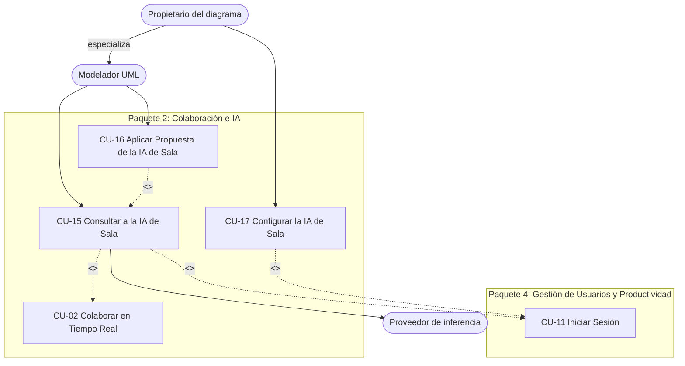

# Ciclo 2 — UmlStudio v2.0 (Segundo Parcial)

> **Metodología**: PUDS (Proceso Unificado de Desarrollo de Software).
> **Alcance del ciclo**: la **IA de sala**, un asistente único y compartido por todos los participantes de una sala colaborativa (CU-15 a CU-17). Todo lo entregado en el [Ciclo 1](CICLO_1.md) (CU-01 a CU-14) debe seguir funcionando.
> **Periodo**: desde el 2026-10-23 hasta la defensa del segundo parcial (miércoles 2026-11-11).
> **Trazabilidad**: requisitos en [`REQUIREMENTS.md`](REQUIREMENTS.md) (MOD-12), arquitectura en [`../ARCHITECTURE.md`](../ARCHITECTURE.md), calidad en [`QUALITY_STANDARDS.md`](QUALITY_STANDARDS.md).

El Ciclo 2 parte de la versión v1.0 y termina en la **release v2.0**. Recorre las cuatro fases de PUDS; Construcción se divide en tres iteraciones.

---

## 1. Fases del ciclo

| Fase             | Objetivo                                                                 | Artefactos y resultados                                                                                                                                | Estado |
| :--------------- | :----------------------------------------------------------------------- | :----------------------------------------------------------------------------------------------------------------------------------------------------- | :----: |
| **Inicio**       | Delimitar la extensión: una IA centralizada que participa en la sala     | Requisitos RF-51…62 y RNF-30…35, actores, CU-15…17, diagnóstico del producto v1.0 y riesgos (sección 3.4)                                              |   🟡   |
| **Elaboración**  | Fijar la arquitectura de la IA de sala y detallar los CU de mayor riesgo | Orquestador en el servidor, réplica del tablero, contratos REST/WS, memoria de sala y topología de inferencia; especificación de CU (sección 4)        |   ⏳   |
| **Construcción** | Implementar los CU en 3 iteraciones (sección 2)                          | Código en `apps/server`, `apps/ai-service`, `apps/webapp` y `packages/core`; pruebas de integración `INT-CU15…17` (sección 5)                          |   ⏳   |
| **Transición**   | Entregar v2.0 en producción con el modelo propio accesible y verificarla | Modelo propio desplegado en un servidor con GPU (solo en la ventana de presentación), respaldo verificado, manual, ensayo con dos equipos y tag `v2.0` |   ⏳   |

✅ terminado · 🟡 en curso · ⏳ pendiente

## 2. Iteraciones de Construcción

| Iteración | Fechas       | Enfoque                                                                                        | Casos de uso        |
| :-------- | :----------- | :--------------------------------------------------------------------------------------------- | :------------------ |
| **I1**    | 23-29 oct    | Réplica del tablero en el servidor y chat de sala compartido (todavía sin IA)                  | CU-15 (base)        |
| **I2**    | 30 oct-5 nov | Orquestador, inferencia, modos mentor/ejecutor, propuestas, política y memoria de sala         | CU-15, CU-16, CU-17 |
| **I3**    | 6-10 nov     | Despliegue del modelo propio para la presentación, moderador proactivo, documentación y ensayo | Transición          |

I1 va primero porque todo lo demás depende de dos cosas: que el servidor **vea** el tablero y que la conversación sea **pública y autoritativa**.

---

## 3. Modelo de casos de uso

### 3.1 Actores

| Actor                        | Tipo                 | Descripción                                                                                                                                                                      |
| :--------------------------- | :------------------- | :------------------------------------------------------------------------------------------------------------------------------------------------------------------------------- |
| **Modelador UML**            | Humano (principal)   | Igual que en el Ciclo 1. En una sala compartida puede consultar a la IA y aplicar sus propuestas                                                                                 |
| **Propietario del diagrama** | Humano (principal)   | Especialización del Modelador UML: quien creó el diagrama (`meta.userId`). Además, configura la IA de su sala                                                                    |
| **Proveedor de inferencia**  | Sistema (secundario) | Modelo de lenguaje que genera las respuestas: el modelo abierto y personalizado del equipo (desplegado en un servidor propio) o, como respaldo rotulado, un proveedor en la nube |

El Cliente MCP Externo del Ciclo 1 no participa de estos CU.

### 3.2 Paquetes y relaciones

Los CU nuevos se agregan al **Paquete 2: Colaboración e IA**. Los CU del Ciclo 1 aparecen solo para mostrar las relaciones.

- **`<<extend>>`**: CU-15 amplía la colaboración (solo existe dentro de una sala de CU-02). CU-16 amplía la consulta: solo ocurre si la respuesta trae una propuesta.
- **`<<include>>`**: CU-15 y CU-17 → CU-11. La IA se dirige a cada persona por su nombre, así que sin sesión no hay consulta.

### 3.3 Catálogo

| CU    | Nombre                             | Actor       | Paquete | Iteración | Prioridad | Riesgo  | RF                   | Estado |
| :---- | :--------------------------------- | :---------- | :-----: | :-------: | :-------- | :------ | :------------------- | :----: |
| CU-15 | Consultar a la IA de Sala          | Modelador   |    2    |  I1, I2   | Alta      | Crítico | RF-51..57, RF-60..62 |   ⏳   |
| CU-16 | Aplicar Propuesta de la IA de Sala | Modelador   |    2    |    I2     | Alta      | Crítico | RF-58                |   ⏳   |
| CU-17 | Configurar la IA de Sala           | Propietario |    2    |    I2     | Media     | Bajo    | RF-59                |   ⏳   |

### 3.4 Riesgos críticos

| Riesgo                                                                    | CU           | Mitigación                                                                   |
| :------------------------------------------------------------------------ | :----------- | :--------------------------------------------------------------------------- |
| IA no determinista: un modelo local chico genera diffs inválidos          | CU-16        | `validateDiff` antes de proponer, confirmación humana y benchmark de modelos |
| Concurrencia: preguntas simultáneas o doble aplicación                    | CU-15, CU-16 | Cola FIFO por sala y _claim_ atómico en Redis                                |
| Disponibilidad del modelo propio (servidor apagado o en arranque en frío) | CU-15        | Respaldo en la nube rotulado en cada respuesta; nunca datos simulados        |
| Arranque en frío de Render durante la defensa                             | Todos        | Precalentar los `/health` antes de la demo                                   |

---

## 4. Especificación de casos de uso

Mismo formato que el Ciclo 1: propósito, precondición, flujo principal, flujos alternativos (FA) y postcondición.

### CU-15: Consultar a la IA de Sala

- **Propósito**: que cualquier participante consulte a la IA compartida de la sala y que todos vean quién preguntó, qué preguntó y qué respondió la IA, dirigida a esa persona.
- **Precondición**: sesión iniciada (CU-11); sala compartida abierta (CU-02); la IA de la sala está habilitada. Cualquier participante puede preguntar: no hay roles entre los desarrolladores de la sala.
- **Flujo principal**:
  1. El participante escribe en el panel de la IA de sala y elige **Preguntar** (modo mentor) o **Pedir cambio** (modo ejecutor).
  2. La webapp confirma primero que la réplica compartida alcanzó la revisión actual y envía su generación y revisión junto con `POST /api/rooms/:diagramId/ai/messages`. El servidor responde `202` con la posición en la cola.
     Este endpoint es solo para el chat compartido: difunde la pregunta a toda la sala y rechaza `privateContext`. El modo **Privado** usa `POST /api/rooms/:diagramId/ai/private-messages`; responde únicamente al solicitante autenticado y no agrega la pregunta ni la respuesta al chat de Redis o a los eventos de sala. La memoria personal se conserva en IndexedDB y solo se envía por esa ruta.
  3. El servidor guarda la pregunta con el autor tomado del JWT y la difunde: todos ven **"Juan → IA"** y el texto.
  4. Todos ven el estado **"IA pensando para Juan"** y la longitud de la cola.
  5. Cuando llega su turno, el servidor arma el contexto: el tablero actual (réplica en el servidor), la memoria de la sala y el rastro propio del solicitante. Luego llama al servicio de inferencia.
  6. La respuesta **empieza con el nombre del solicitante**, se guarda como respuesta a esa pregunta y se difunde a todos. En modo mentor no modifica el tablero.
  7. En modo ejecutor, la respuesta trae además una **propuesta de cambio** validada (continúa en CU-16).
- **FA**:
  - **FA-01 Voz**: el participante graba la pregunta; se transcribe y se publica como pregunta de ese autor. Sigue en el paso 3.
  - **FA-02 Consultas simultáneas**: se atienden en orden de llegada y cada respuesta se dirige a su autor, sin mezclar contextos. Con la cola llena → `429` y aviso al autor.
  - **FA-03 Proveedor local no disponible**: el servidor usa el respaldo en la nube y lo rotula en la respuesta. Si ningún proveedor responde, la pregunta queda como **fallida** con la causa real, visible para todos. Nunca se simula una respuesta.
  - **FA-04 Política**: si la IA está desactivada, o si se pide un cambio y la sala solo admite el modo mentor → `403` con el motivo, visible para el autor.
  - **FA-05 Ingreso a la sala**: al entrar, el participante ve el historial de la conversación de la sala.
  - **FA-06 Moderador proactivo** (si la política lo habilita): tras un periodo sin cambios, la IA publica como máximo una observación de diseño dirigida al autor del elemento observado.
- **Postcondición**: la pregunta y la respuesta quedan en el historial de la sala y son visibles para todos; la memoria de la sala y el rastro del solicitante quedan actualizados.

### CU-16: Aplicar Propuesta de la IA de Sala

- **Propósito**: aplicar en el tablero compartido, **una sola vez** y con autor registrado, un cambio propuesto por la IA.
- **Precondición**: una respuesta de CU-15 tiene una propuesta **pendiente** (la sala permite que la IA entregue soluciones). Cualquier participante puede aplicarla o rechazarla.
- **Flujo principal**:
  1. Todos ven la propuesta (elementos agregados, modificados y eliminados) junto a la respuesta.
  2. Un participante pulsa **Aplicar**; la webapp reclama la propuesta (`POST …/proposals/:messageId/claim`).
  3. El servidor revalida la propuesta contra el tablero actual y concede el _claim_ de forma atómica (`200`).
  4. El cliente aplica el `ModelDiff` con `applyDiff`; Yjs propaga el cambio a todos los tableros.
  5. El cliente informa el resultado; todos ven **"Aplicada por Ana"**.
- **FA**:
  - **FA-01 Aplicación simultánea**: si dos participantes pulsan a la vez, solo el primero recibe `200`; el segundo recibe `409` y ve quién la aplicó.
  - **FA-02 Propuesta desactualizada**: si el tablero cambió y la propuesta ya no aplica → `stale`; se ofrece volver a pedirla.
  - **FA-03 Rechazo**: un participante la rechaza; queda **rechazada** para todos.
  - **FA-04 Aplicación automática**: si la política está en modo `auto`, el cliente del solicitante la aplica al recibirla.
  - **FA-05 Fallo al aplicar**: queda **fallida** con la causa; un _claim_ sin resultado expira a los 60 s.
- **Postcondición**: el cambio está en todos los tableros exactamente una vez y la propuesta registra quién la aplicó.

### CU-17: Configurar la IA de Sala

- **Propósito**: que el propietario del diagrama decida qué puede hacer la IA en su sala; en particular, si puede **entregar soluciones** modificando el diagrama o solo actuar como mentor.
- **Precondición**: sesión iniciada (CU-11); el usuario es el propietario del diagrama.
- **Flujo principal**:
  1. El propietario abre la configuración de la IA de sala.
  2. Edita: IA habilitada; entrega de soluciones permitida (o solo mentor); aplicación de propuestas con confirmación de un participante o automática; moderador proactivo.
  3. La webapp envía `PUT /api/rooms/:diagramId/ai/policy`; el servidor verifica que sea el propietario y guarda la política.
  4. Todos los participantes ven la nueva configuración al instante.
- **FA**: FA-01 un participante que no es propietario no ve el control; si llama al endpoint → `403`. FA-02 al desactivar la IA, la consulta en curso termina y las encoladas se cancelan con aviso a sus autores.
- **Postcondición**: la política queda guardada y rige las siguientes consultas de la sala.

---

## 5. Pruebas de integración por caso de uso

Se mantiene la regla del Ciclo 1: **al menos una prueba de integración automatizada por CU** (`INT-CUxx` = `cu-xx-*.test.ts`). Las pruebas `INT-CU01…14` siguen corriendo en el CI como regresión.

| ID       | Archivo (previsto)                                            | Qué verifica                                                                                                                     |
| :------- | :------------------------------------------------------------ | :------------------------------------------------------------------------------------------------------------------------------- |
| INT-CU15 | `apps/server/test/integration/cu-15-room-ai-query.test.ts`    | Dos clientes reciben la pregunta y la respuesta con el nombre del autor; dos preguntas simultáneas reciben cada una su respuesta |
| INT-CU16 | `apps/server/test/integration/cu-16-room-ai-proposal.test.ts` | Dos _claims_ simultáneos: uno `200` y otro `409`; propuesta desactualizada → `stale`                                             |
| INT-CU17 | `apps/server/test/integration/cu-17-room-ai-policy.test.ts`   | Un participante que no es propietario recibe `403`; el cambio de política llega a todos                                          |

En `ai-service`, el endpoint interno de la sala se prueba con `unittest`, un adaptador _stub_ y el rechazo sin token.

## 6. Cierre del ciclo

| Criterio                                                                | Estado |
| :---------------------------------------------------------------------- | :----: |
| CU-15 a CU-17 implementados y desplegados en producción                 |   ⏳   |
| Una prueba de integración por CU nuevo y regresión del Ciclo 1 en verde |   ⏳   |
| Modelo local accesible en producción y respaldo verificado              |   ⏳   |
| Arquitectura actualizada (vistas de procesos y despliegue)              |   ⏳   |
| Manual de usuario actualizado (`apps/docs`)                             |   ⏳   |
| Tag `v2.0` creado                                                       |   ⏳   |
