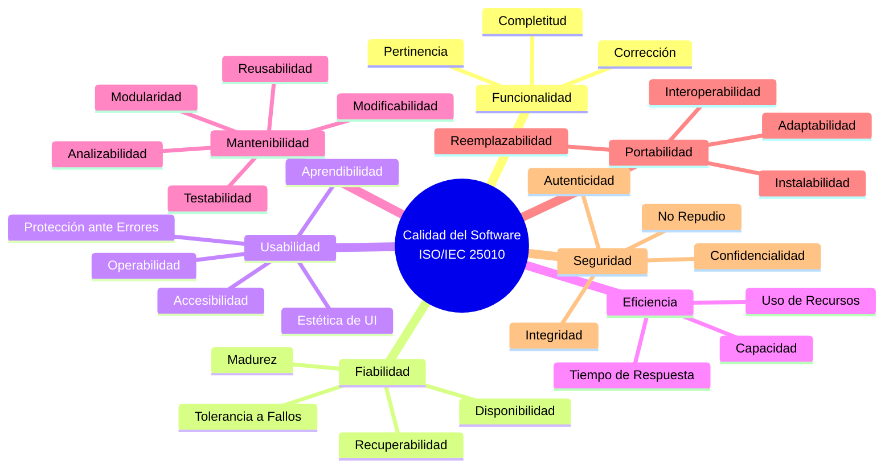

# Estándares de Calidad del Software — UmlStudio

## Mapeo de ISO/IEC 25010 al Proyecto

> **Versión**: 1.0 (Ciclo 1)
> **Estándar de Referencia**: ISO/IEC 25010:2023 — Systems and Software Quality Requirements and Evaluation (SQuaRE)
> **Trazabilidad**: Requisitos en [`REQUIREMENTS.md`](REQUIREMENTS.md), Arquitectura en [`../ARCHITECTURE.md`](../ARCHITECTURE.md), pruebas por CU en [`CICLO_1.md`](CICLO_1.md).

---

## 1. Marco de Referencia

La norma **ISO/IEC 25010** define un modelo de calidad del producto de software estructurado en **8 características principales**. Para el contexto del examen se han agrupado en **7 estándares de calidad**, fusionando Compatibilidad dentro de Portabilidad.

---

## 2. Mapeo Detallado: 7 Estándares → UmlStudio

### 2.1 Funcionalidad (Functional Suitability)

> _¿El sistema hace lo que debe hacer?_

| Sub-característica        | Evidencia en UmlStudio                                                                                                                                                                                              | Módulos | Verificación                                                |
| ------------------------- | ------------------------------------------------------------------------------------------------------------------------------------------------------------------------------------------------------------------- | ------- | ----------------------------------------------------------- |
| **Completitud Funcional** | 50 requisitos funcionales (RF-01 a RF-50) y 29 no funcionales (RNF-01 a RNF-29) cubriendo modelado UML, colaboración, IA, generación de código, XMI, versionado/snapshots, MCP, autenticación y despliegue híbrido. | Todos   | Matriz de trazabilidad RF → CU                              |
| **Corrección Funcional**  | Validación contra schema JSON (`uml-model-4.schema.json`), conformidad OMG UML 2.5, pruebas Vitest con TDD.                                                                                                         | MOD-01  | `pnpm test` — 100% pass rate                                |
| **Pertinencia Funcional** | Exclusividad de Diagramas de Clases UML. No se incluyen diagramas ajenos al dominio.                                                                                                                                | MOD-01  | Regla de dominio en `AGENTS.md` y tipo único `ClassDiagram` |

**Artefactos de Evidencia:**

- [`REQUIREMENTS.md`](REQUIREMENTS.md)
- [`packages/core/schema/uml-model-4.schema.json`](../packages/core/schema/uml-model-4.schema.json)
- Reportes de Vitest

---

### 2.2 Fiabilidad (Reliability)

> _¿El sistema funciona correctamente bajo condiciones normales y adversas?_

| Sub-característica      | Evidencia en UmlStudio                                                                                                                     | Módulos        | Verificación                                  |
| ----------------------- | ------------------------------------------------------------------------------------------------------------------------------------------ | -------------- | --------------------------------------------- |
| **Madurez**             | CRDT (Yjs) garantiza convergencia sin conflictos. Transacciones Lua atómicas en Redis evitan race conditions.                              | MOD-02         | Tests de concurrencia                         |
| **Disponibilidad**      | Reconexión automática del WebSocket (RNF-06). En el plan gratuito de Render hay arranques en frío de 30–60 s.                              | MOD-02         | `/health` de cada servicio                    |
| **Tolerancia a Fallos** | Diagramas locales en el navegador. CRDT fusiona cambios offline al reconectar. Errores de IA mostrados con su causa real.                  | MOD-01, MOD-02 | Test de desconexión/reconexión                |
| **Recuperabilidad**     | Snapshots en Redis e IndexedDB permiten rollback histórico. Control de versiones con funciones Lua (`commit_snapshot`, `restore_version`). | MOD-08         | Test de restauración de snapshot (`INT-CU08`) |

**Artefactos de Evidencia:**

- [`DATABASE.md`](DATABASE.md) — Funciones Lua `commit_snapshot`, `restore_version`
- Tests de concurrencia Vitest

---

### 2.3 Usabilidad (Usability)

> _¿Es fácil de usar, aprender y agradable visualmente?_

| Sub-característica          | Evidencia en UmlStudio                                                                                    | Módulos       | Verificación                                        |
| --------------------------- | --------------------------------------------------------------------------------------------------------- | ------------- | --------------------------------------------------- |
| **Aprendibilidad**          | Drag & drop intuitivo. Atajos de teclado documentados (`HowToUseModal`). Manual de usuario (`apps/docs`). | MOD-01        | Usability testing                                   |
| **Operabilidad**            | Undo/redo, zoom, fit-view y atajos de teclado.                                                            | MOD-01        | Checklist de atajos                                 |
| **Protección ante Errores** | Diff visual antes de aplicar cambios de IA (RF-13). Confirmación en operaciones destructivas.             | MOD-03        | Test de flujo de confirmación                       |
| **Estética de UI**          | Design System atómico con paleta Coolors, tipografía Inter, Dark/Light themes, glassmorphism.             | `packages/ui` | Auditoría visual contra [`DESIGN.md`](../DESIGN.md) |
| **Accesibilidad**           | Componentes Radix Primitives con roles ARIA nativos. Contraste verificado en ambos temas.                 | `packages/ui` | Lighthouse Accessibility score                      |

**Artefactos de Evidencia:**

- [`../DESIGN.md`](../DESIGN.md)
- Manual de usuario en `apps/docs`

---

### 2.4 Eficiencia (Performance Efficiency)

> _¿El sistema responde rápido y usa recursos de forma óptima?_

| Sub-característica      | Evidencia en UmlStudio                                                                                    | Métrica                | Módulos                |
| ----------------------- | --------------------------------------------------------------------------------------------------------- | ---------------------- | ---------------------- |
| **Tiempo de Respuesta** | Canvas a 60 FPS (RNF-01). Rutas A\* en ≤50ms (RNF-02). LLM en ≤5s (RNF-07). XMI import en ≤3s (RNF-13).   | Performance.now()      | MOD-01, MOD-03, MOD-05 |
| **Uso de Recursos**     | Worker threads en el servidor para conversión SVG/PNG/PDF. Code splitting por ruta. Updates Yjs binarios. | Chrome DevTools Memory | MOD-01, MOD-02         |
| **Capacidad**           | ≤100 nodos a 60 FPS. N clientes simultáneos vía WebSocket relay.                                          | Benchmark testing      | MOD-01, MOD-02         |

**Artefactos de Evidencia:**

- Benchmarks de Performance.now()
- Chrome DevTools profiling screenshots

---

### 2.5 Mantenibilidad (Maintainability)

> _¿Es fácil de modificar, extender, analizar y probar?_

| Sub-característica       | Evidencia en UmlStudio                                                                                         | Herramientas / Verificación             |
| ------------------------ | -------------------------------------------------------------------------------------------------------------- | --------------------------------------- |
| **Modularidad**          | Monorepo pnpm: paquetes `core` y `ui`; apps `webapp`, `server`, `codegen`, `ai-service`, `mcp-server`, `docs`. | `pnpm-workspace.yaml`                   |
| **Reusabilidad**         | `@umlstudio/core` es una librería agnóstica reutilizable. `@umlstudio/ui` es un Design System independiente.   | `workspace:*`                           |
| **Analizabilidad**       | Logs estructurados en el servidor; contratos tipados (`ModelDiff`, esquema JSON v4).                           | `logger`, esquema JSON                  |
| **Estándares de Código** | ESLint estricto, Prettier, tipado TypeScript riguroso y cero advertencias/errores.                             | `pnpm lint`, `pnpm format:check`        |
| **Modificabilidad**      | Conventional Commits, adaptadores de IA intercambiables (Strategy), separación `routes/`–`services/`.          | [`CONTRIBUTING.md`](../CONTRIBUTING.md) |
| **Testabilidad**         | Vitest como runner. Pruebas unitarias y una prueba de integración por CU (`INT-CU01` a `INT-CU14`).            | `pnpm test:all`                         |

**Artefactos de Evidencia:**

- [`../ARCHITECTURE.md`](../ARCHITECTURE.md) — Módulos, capas y decisiones
- [`CICLO_1.md`](CICLO_1.md) — Matriz de pruebas de integración por CU
- Reporte de ESLint (`pnpm lint`) y de cobertura (`pnpm --filter <paquete> test:coverage`)

---

### 2.6 Portabilidad (Portability) + Compatibilidad

> _¿Funciona en diferentes entornos y es interoperable con otros sistemas?_

| Sub-característica    | Evidencia en UmlStudio                                                                                                                        | Módulos                |
| --------------------- | --------------------------------------------------------------------------------------------------------------------------------------------- | ---------------------- |
| **Adaptabilidad**     | Despliegue: SPA en Cloudflare Pages y servicios en contenedores Docker (Render en producción, Docker Compose en local).                       | RNF-26..29             |
| **Instalabilidad**    | `pnpm install && pnpm dev` para desarrollo. `docker compose up` levanta el stack completo.                                                    | RNF-27                 |
| **Interoperabilidad** | XMI para Enterprise Architect (RF-19..21). MCP para agentes IA (RF-37..39). OpenAPI 3.0 y Postman (RF-29, RF-31). JSON Schema para el modelo. | MOD-05, MOD-09, MOD-07 |
| **Reemplazabilidad**  | Adaptadores de IA intercambiables por configuración: Cloudflare, OpenRouter, Gemini, LM Studio y Ollama.                                      | MOD-03                 |

**Artefactos de Evidencia:**

- Archivo XMI exportado y abierto en Enterprise Architect
- Servidor MCP funcionando en Claude Desktop o Cursor
- Despliegue en Cloudflare Pages + Render

---

### 2.7 Seguridad (Security)

> _¿El sistema protege datos e integridad?_

| Sub-característica        | Evidencia en UmlStudio                                                                                                                                          | Módulos        |
| ------------------------- | --------------------------------------------------------------------------------------------------------------------------------------------------------------- | -------------- |
| **Confidencialidad**      | Autenticación JWT y hash bcrypt (RF-44..50). TLS en producción (RNF-29). El servicio de IA no persiste datos de usuario. Secretos solo en variables de entorno. | MOD-11, MOD-03 |
| **Integridad**            | CRDT Yjs garantiza convergencia. Funciones Lua atómicas en Redis. Diffs de IA validados antes de aplicarse.                                                     | MOD-02, MOD-08 |
| **Supply Chain Security** | pnpm exclusivo (cero npm). `pnpm audit`. Lockfile versionado (`pnpm-lock.yaml`).                                                                                | Transversal    |
| **Sanitización**          | Validación de entradas con Zod (server) y Pydantic (ai-service); modelo validado contra JSON Schema.                                                            | MOD-03, MOD-01 |

**Artefactos de Evidencia:**

- Reporte de `pnpm audit`
- Esquemas Zod en `apps/server/src/routes/_schemas.ts`

---

## 3. Checklist de Verificación por Estándar

| #   | Estándar       | Verificación                                                 | Comando / Artefacto                          | Estado |
| --- | -------------- | ------------------------------------------------------------ | -------------------------------------------- | ------ |
| 1   | Funcionalidad  | Todos los RF implementados y trazables a CU                  | Matriz de trazabilidad en `REQUIREMENTS.md`  | ⏳     |
| 2   | Fiabilidad     | Tests de concurrencia + reconexión + rollback                | `pnpm test` + `DATABASE.md` Lua tests        | ⏳     |
| 3   | Usabilidad     | Auditoría visual + Lighthouse Accessibility                  | Chrome Lighthouse + `DESIGN.md`              | ⏳     |
| 4   | Eficiencia     | Benchmarks de rendimiento documentados (60 FPS, ≤50ms A\*)   | Performance profiling                        | ⏳     |
| 5   | Mantenibilidad | ESLint 0 errors + Vitest 100% pass + Matriz CU               | `pnpm lint` + `pnpm test:all` + `CICLO_1.md` | ⏳     |
| 6   | Portabilidad   | XMI round-trip + Multi-Adapter + Cloudflare/Render           | Tests XMI + Docker Compose + OpenAPI         | ⏳     |
| 7   | Seguridad      | pnpm audit sin críticas/altas + TLS + validación de entradas | `pnpm audit`                                 | ⏳     |
