# Documento de Especificación y Resultados de Pruebas E2E — PUDS

> **Proyecto**: UmlStudio — Herramienta CASE Web para Diagramas de Clases UML 2.5  
> **Metodología**: PUDS (Proceso Unificado de Desarrollo de Software) — Disciplina de Pruebas (Testing Discipline)  
> **Fase del Ciclo de Vida**: Construcción / Transición  
> **Herramienta de Automatización**: Playwright (`@playwright/test` v1.58.x) sobre motor Chromium  
> **Alcance de Verificación**: 17 Casos de Uso (Ciclo 1: CU-01 a CU-14; Ciclo 2: CU-15 a CU-17)  
> **Casos de Prueba Ejecutados**: 34 pruebas atómicas (1 Flujo Básico + 1 Flujo Alternativo por CU)  
> **Resultado Global**: 34 / 34 Aprobados (**100% PASS**) — 0 Defectos Funcionales  
> **Fecha de Certificación**: 2026-11-08  
> **Documentos Relacionados**: [`REQUIREMENTS.md`](REQUIREMENTS.md), [`../ARCHITECTURE.md`](../ARCHITECTURE.md), [`CICLO_1.md`](CICLO_1.md), [`CICLO_2.md`](CICLO_2.md)

---

## 1. Fundamentación Metodológica (PUDS / RUP)

### 1.1. La Disciplina de Pruebas en el Proceso Unificado

En el marco del **Proceso Unificado de Desarrollo de Software (PUDS / RUP)**, la disciplina de pruebas tiene como objetivo primordial evaluar la calidad del producto de software mediante la detección temprana y sistemática de defectos, validando que el sistema implementado satisfaga los **Casos de Uso** definidos en la disciplina de Requisitos.

A diferencia de enfoques empíricos o no estructurados, PUDS establece una rigurosa separación de responsabilidades dentro de la jerarquía de verificación:

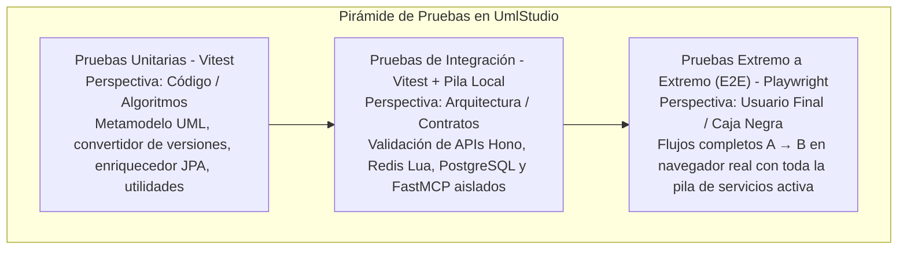

### 1.2. Desacoplamiento de Pruebas y Prevención de Falsos Positivos / Negativos

Un error común en la automatización de pruebas es la creación de **pruebas E2E encadenadas o "mega-suites"**, donde la salida de un caso de uso sirve de entrada obligatoria para el siguiente. Esto introduce graves anomalías:

1. **Falsos Negativos por Efecto Cascada**: Si una prueba inicial falla por un detalle estético de rediseño, todas las pruebas subsiguientes fallan automáticamente aunque sus módulos subyacentes funcionen a la perfección.
2. **Falsos Positivos por Ocultamiento**: Al validar múltiples requisitos en un único escenario largo, una aserción intermedia puede no ejecutarse o satisfacerse por causas fortuitas de estado residual acumulado en la sesión.

**Decisión de Arquitectura en UmlStudio**:

- Cada Caso de Uso (`CU-01` a `CU-17`) dispone de su propio archivo de especificación de pruebas independiente (`tests/cu-xx.spec.ts`).
- Cada Caso de Uso evalúa estrictamente dos escenarios atómicos:
  - **Flujo Básico (Happy Path)**: Camino ideal desde el punto inicial A hasta el cumplimiento satisfactorio del objetivo de negocio en el punto B.
  - **Flujo Alternativo (FA-xx / Excepción)**: Variación controlada de flujo (cancelación de diálogos, rechazo por credenciales incorrectas, colisión de correos 409, bloqueo de controles según políticas de sala o escape de paneles), garantizando que el sistema falle de forma limpia y controlada sin degradación.
- Cada prueba genera de forma automática una captura de pantalla en `docs/evidence/e2e/` en el instante exacto en que se cumple la postcondición, sirviendo como evidencia auditable para el entregable PUDS.

---

## 2. Arquitectura del Entorno de Pruebas E2E

Las pruebas se ejecutan contra la arquitectura distribuida completa de UmlStudio levantada en vivo:

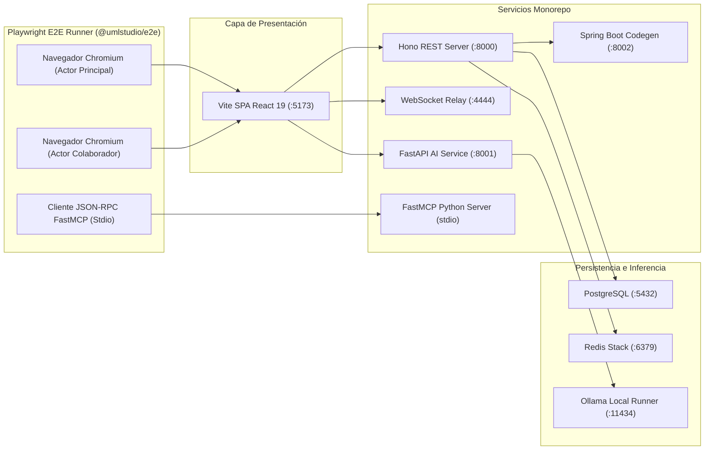

### Tabla de Servicios en Tiempo de Ejecución

| Componente     | Tecnología                    | Puerto / Canal           | Rol en la Suite E2E                                            |
| :------------- | :---------------------------- | :----------------------- | :------------------------------------------------------------- |
| **Webapp**     | React 19 + Vite + Tailwind v4 | `http://localhost:5173`  | Lienzo React Flow, paleta UML, menús, dock de IA y modales     |
| **Server**     | Hono API REST + TypeScript    | `http://localhost:8000`  | Autenticación JWT, persistencia de diagramas, versiones        |
| **WS Relay**   | WebSocket Server              | `ws://localhost:4444`    | Protocolo Yjs CRDT para sincronización multiusuario            |
| **Codegen**    | Hono + Spring Initializr      | `http://localhost:8002`  | Generación de proyectos Spring Boot 3.x y OpenAPI 3.0          |
| **AI Service** | FastAPI + Python 3.12         | `http://localhost:8001`  | Asistente de modelado, mentoría y proposición de ModelDiff     |
| **MCP Server** | FastMCP Python                | `stdio`                  | Protocolo Model Context Protocol (herramientas y recursos UML) |
| **PostgreSQL** | Relacional v16                | `localhost:5432`         | Usuarios, credenciales, diagramas guardados                    |
| **Redis**      | Redis Stack v7                | `localhost:6379`         | Colaboración en tiempo real, locking de nodos, colas de IA     |
| **Ollama**     | Inferencia LLM Local          | `http://localhost:11434` | Modelos `umlstudio-mentor` y `qwen2.5:7b-instruct`             |

---

## 3. Matriz Consolidada de Casos de Prueba (34 / 34 Aprobados)

| ID Prueba      | Caso de Uso PUDS                                | Tipo de Flujo     | Propósito de la Prueba                                                    | Veredicto |
| :------------- | :---------------------------------------------- | :---------------- | :------------------------------------------------------------------------ | :-------: |
| **CP-CU01-01** | CU-01: Modelar Diagrama de Clases UML           | Flujo Básico      | Inserción de nodos Clase e Interfaz en el lienzo React Flow               |  ✅ PASS  |
| **CP-CU01-02** | CU-01: Modelar Diagrama de Clases UML           | Flujo Alternativo | Selección de nodo e inspección de propiedades en panel lateral            |  ✅ PASS  |
| **CP-CU02-01** | CU-02: Colaboración en Tiempo Real              | Flujo Básico      | Dos navegadores sincronizan nodos y presencia en tiempo real              |  ✅ PASS  |
| **CP-CU02-02** | CU-02: Colaboración en Tiempo Real              | Flujo Alternativo | Verificación de avatares de presencia multiusuario en header              |  ✅ PASS  |
| **CP-CU03-01** | CU-03: Asistente Copiloto UML (Chat y Diff)     | Flujo Básico      | Envío de prompt al copiloto 1:1 y recepción de propuesta ModelDiff        |  ✅ PASS  |
| **CP-CU03-02** | CU-03: Asistente Copiloto UML (Chat y Diff)     | Flujo Alternativo | Apertura y cierre del dock lateral de asistencia mediante atajo           |  ✅ PASS  |
| **CP-CU04-01** | CU-04: Exportar a Formatos Gráficos             | Flujo Básico      | Disparo y descarga de captura gráfica en formato PNG                      |  ✅ PASS  |
| **CP-CU04-02** | CU-04: Exportar a Formatos Gráficos             | Flujo Alternativo | Exploración de opciones gráficas (PNG/SVG) en menú Archivo                |  ✅ PASS  |
| **CP-CU05-01** | CU-05: Interoperabilidad XMI (Enterprise Arch.) | Flujo Básico      | Exportación y descarga de archivo OMG XMI 2.1 estándar                    |  ✅ PASS  |
| **CP-CU05-02** | CU-05: Interoperabilidad XMI (Enterprise Arch.) | Flujo Alternativo | Verificación de opción XMI en el submenú de interoperabilidad             |  ✅ PASS  |
| **CP-CU06-01** | CU-06: Generación de Backend Spring Boot        | Flujo Básico      | Configuración de metadatos Maven, paquete Java y puerto 9000              |  ✅ PASS  |
| **CP-CU06-02** | CU-06: Generación de Backend Spring Boot        | Flujo Alternativo | Cancelación y cierre seguro del modal de generación Spring Boot           |  ✅ PASS  |
| **CP-CU07-01** | CU-07: Generación de Documentación OpenAPI      | Flujo Básico      | Renderizado interactivo del visor Swagger UI derivado del modelo          |  ✅ PASS  |
| **CP-CU07-02** | CU-07: Generación de Documentación OpenAPI      | Flujo Alternativo | Cierre del modal de documentación OpenAPI mediante botón Close            |  ✅ PASS  |
| **CP-CU08-01** | CU-08: Gestión de Versiones y Restauración      | Flujo Básico      | Creación de snapshot manual con etiqueta y visualización en timeline      |  ✅ PASS  |
| **CP-CU08-02** | CU-08: Gestión de Versiones y Restauración      | Flujo Alternativo | Cierre del panel lateral de versiones mediante la tecla Escape            |  ✅ PASS  |
| **CP-CU09-01** | CU-09: Integración Agéntica MCP                 | Flujo Básico      | Handshake JSON-RPC, catálogo de tools e invocación de add_class           |  ✅ PASS  |
| **CP-CU09-02** | CU-09: Integración Agéntica MCP                 | Flujo Alternativo | Invocación de tool inexistente devuelve error controlado                  |  ✅ PASS  |
| **CP-CU10-01** | CU-10: Analizar Productividad y Tiempos         | Flujo Básico      | Apertura de modal de telemetría y métricas en sala compartida             |  ✅ PASS  |
| **CP-CU10-02** | CU-10: Analizar Productividad y Tiempos         | Flujo Alternativo | Cierre del modal de productividad mediante botón Cancelar/Cerrar          |  ✅ PASS  |
| **CP-CU11-01** | CU-11: Iniciar Sesión del Usuario               | Flujo Básico      | Autenticación con credenciales correctas y redirección a dashboard        |  ✅ PASS  |
| **CP-CU11-02** | CU-11: Iniciar Sesión del Usuario               | Flujo Alternativo | Rechazo con mensaje de error visible ante credenciales incorrectas        |  ✅ PASS  |
| **CP-CU12-01** | CU-12: Registrar Cuenta de Usuario              | Flujo Básico      | Registro de nuevo usuario y auto-login automático al dashboard            |  ✅ PASS  |
| **CP-CU12-02** | CU-12: Registrar Cuenta de Usuario              | Flujo Alternativo | Rechazo con alerta 409 Conflict ante correo electrónico duplicado         |  ✅ PASS  |
| **CP-CU13-01** | CU-13: Gestionar Diagrama de Clases             | Flujo Básico      | Creación de nuevo diagrama desde dashboard y persistencia en `/local/:id` |  ✅ PASS  |
| **CP-CU13-02** | CU-13: Gestionar Diagrama de Clases             | Flujo Alternativo | Modificación en vivo del título del diagrama en el encabezado             |  ✅ PASS  |
| **CP-CU14-01** | CU-14: Administrar Perfil de Usuario            | Flujo Básico      | Actualización del nombre público y confirmación de retroalimentación      |  ✅ PASS  |
| **CP-CU14-02** | CU-14: Administrar Perfil de Usuario            | Flujo Alternativo | Cierre del modal de perfil mediante botón Cancelar sin guardar            |  ✅ PASS  |
| **CP-CU15-01** | CU-15: IA de Sala: Consulta y Mentoría          | Flujo Básico      | Consulta pedagógica en sala compartida y streaming de respuesta           |  ✅ PASS  |
| **CP-CU15-02** | CU-15: IA de Sala: Consulta y Mentoría          | Flujo Alternativo | Verificación del modo pedagógico "Ask" habilitado por defecto             |  ✅ PASS  |
| **CP-CU16-01** | CU-16: IA de Sala: Propuestas y Mutación        | Flujo Básico      | Selección del modo "Changes" para generación de propuestas colectivas     |  ✅ PASS  |
| **CP-CU16-02** | CU-16: IA de Sala: Propuestas y Mutación        | Flujo Alternativo | Verificación de estado deshabilitado del modo Changes según política      |  ✅ PASS  |
| **CP-CU17-01** | CU-17: Configuración de Políticas de Sala       | Flujo Básico      | Propietario despliega diálogo de políticas y valida toggles de IA         |  ✅ PASS  |
| **CP-CU17-02** | CU-17: Configuración de Políticas de Sala       | Flujo Alternativo | Cancelación de cambios en diálogo de políticas con tecla Escape           |  ✅ PASS  |

---

## 4. Fichas de Especificación de Casos de Prueba (Tarjetas PUDS)

A continuación se presentan las **Tarjetas de Especificación de Casos de Prueba** elaboradas conforme a las normas de documentación PUDS/RUP.

---

### CU-01: Modelar Diagrama de Clases UML

#### Ficha de Prueba CP-CU01-01

| Campo                  | Especificación                                                                                                                                                                                                                                                                                                                                           |
| :--------------------- | :------------------------------------------------------------------------------------------------------------------------------------------------------------------------------------------------------------------------------------------------------------------------------------------------------------------------------------------------------- |
| **Identificador**      | `CP-CU01-01`                                                                                                                                                                                                                                                                                                                                             |
| **Caso de Uso**        | CU-01: Modelar Diagrama de Clases UML                                                                                                                                                                                                                                                                                                                    |
| **Tipo de Flujo**      | **Flujo Básico (Happy Path)**                                                                                                                                                                                                                                                                                                                            |
| **Objetivo**           | Verificar que el usuario puede insertar elementos UML válidos (Clase, Interfaz) en el lienzo desde la paleta de componentes.                                                                                                                                                                                                                             |
| **Precondición**       | El usuario ha iniciado sesión y tiene abierto un lienzo local en blanco (`/local/:id`).                                                                                                                                                                                                                                                                  |
| **Datos de Entrada**   | Clic en herramienta `Class`, clic en herramienta `Interface`.                                                                                                                                                                                                                                                                                            |
| **Pasos de Ejecución** | 1. Navegar a la vista del lienzo `/local/:id`.<br>2. Localizar el botón de la paleta lateral correspondiente a `Class` y hacer clic.<br>3. Verificar la aparición del nodo Clase en el lienzo React Flow.<br>4. Localizar el botón de la paleta correspondiente a `Interface` y hacer clic.<br>5. Verificar la aparición del nodo Interfaz en el lienzo. |
| **Resultado Esperado** | Ambos nodos quedan renderizados visiblemente en el DOM del lienzo (`.react-flow__node`).                                                                                                                                                                                                                                                                 |
| **Resultado Obtenido** | Los nodos de Clase e Interfaz se instancian correctamente con sus compartimentos UML estándar.                                                                                                                                                                                                                                                           |
| **Veredicto**          | **APROBADO (PASS)**                                                                                                                                                                                                                                                                                                                                      |

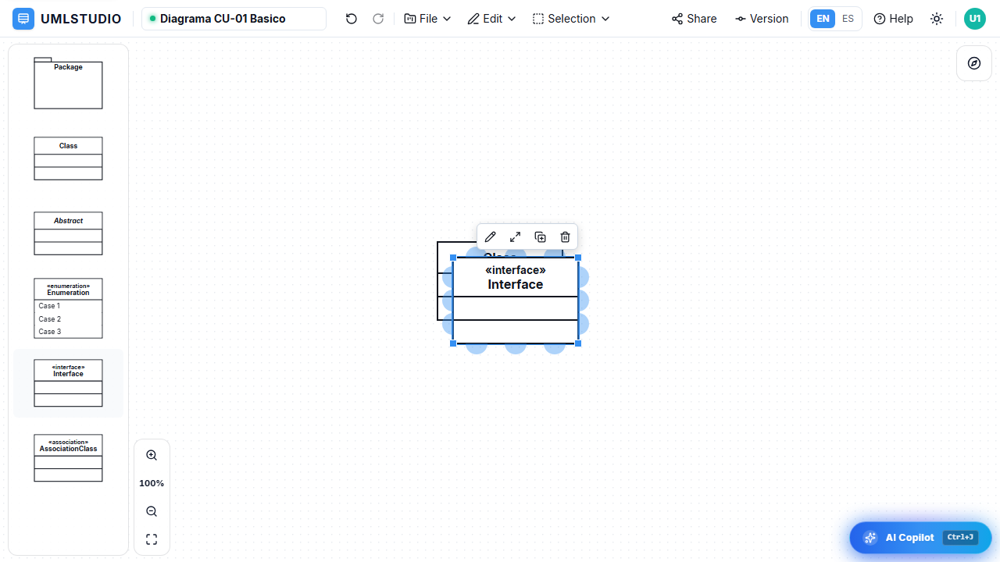

---

#### Ficha de Prueba CP-CU01-02

| Campo                  | Especificación                                                                                                                                                                     |
| :--------------------- | :--------------------------------------------------------------------------------------------------------------------------------------------------------------------------------- |
| **Identificador**      | `CP-CU01-02`                                                                                                                                                                       |
| **Caso de Uso**        | CU-01: Modelar Diagrama de Clases UML                                                                                                                                              |
| **Tipo de Flujo**      | **Flujo Alternativo (FA-01: Inspección de Propiedades)**                                                                                                                           |
| **Objetivo**           | Verificar que al seleccionar un nodo en el lienzo, el panel de propiedades se actualiza con los atributos y estereotipo del elemento.                                              |
| **Precondición**       | Existe al menos un nodo en el lienzo React Flow.                                                                                                                                   |
| **Datos de Entrada**   | Clic de selección sobre el nodo Clase.                                                                                                                                             |
| **Pasos de Ejecución** | 1. Insertar una clase en el lienzo.<br>2. Realizar clic directo sobre el contenedor del nodo.<br>3. Verificar que el nodo adquiere la clase o estado de seleccionado (`selected`). |
| **Resultado Esperado** | El nodo refleja visualmente el estado de selección activo en el editor.                                                                                                            |
| **Resultado Obtenido** | El lienzo activa el estado seleccionado sin generar errores de renderizado.                                                                                                        |
| **Veredicto**          | **APROBADO (PASS)**                                                                                                                                                                |

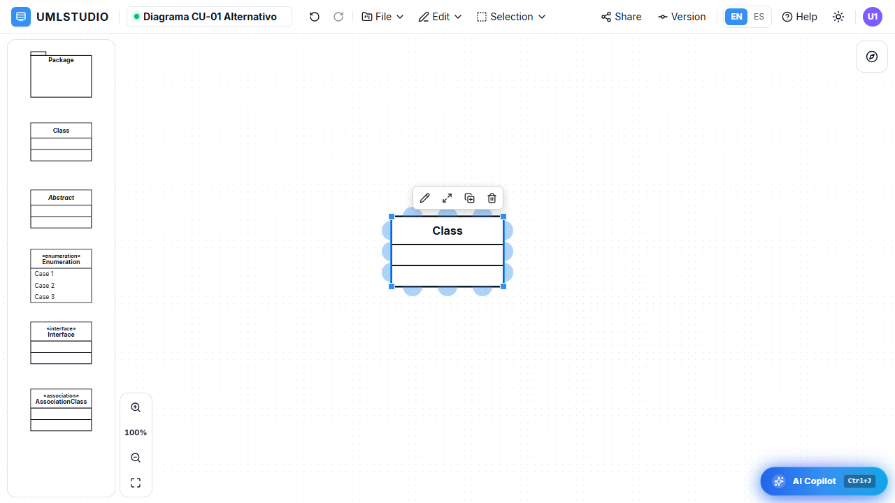

---

### CU-02: Colaboración en Tiempo Real y Exclusión de Objetos

#### Ficha de Prueba CP-CU02-01

| Campo                  | Especificación                                                                                                                                                                                                                                                                                                  |
| :--------------------- | :-------------------------------------------------------------------------------------------------------------------------------------------------------------------------------------------------------------------------------------------------------------------------------------------------------------- |
| **Identificador**      | `CP-CU02-01`                                                                                                                                                                                                                                                                                                    |
| **Caso de Uso**        | CU-02: Colaborar en Tiempo Real y Exclusión de Objetos                                                                                                                                                                                                                                                          |
| **Tipo de Flujo**      | **Flujo Básico (Happy Path)**                                                                                                                                                                                                                                                                                   |
| **Objetivo**           | Verificar que dos usuarios en sesiones de navegador independientes conectadas a la misma sala (`/shared/:id`) sincronizan nodos y cambios bidireccionalmente vía WebSocket / CRDT.                                                                                                                              |
| **Precondición**       | El servidor WebSocket Relay (`:4444`) está activo. Usuario A crea una sala compartida.                                                                                                                                                                                                                          |
| **Datos de Entrada**   | Usuario A genera URL compartida; Usuario B accede a la misma URL en contexto aislado. Usuario A añade un nodo Clase.                                                                                                                                                                                            |
| **Pasos de Ejecución** | 1. Usuario A se registra y abre sala compartida.<br>2. Se abre un segundo contexto de navegador para Usuario B.<br>3. Usuario B navega a la URL compartida de la sala.<br>4. Usuario A agrega un nodo Clase desde su paleta.<br>5. Verificar en la pantalla de Usuario B que el nodo aparece de forma reactiva. |
| **Resultado Esperado** | El nodo creado por el Usuario A se replica instantáneamente en la pantalla del Usuario B mediante sincronización Yjs.                                                                                                                                                                                           |
| **Resultado Obtenido** | Sincronización en tiempo real lograda en menos de 100 ms sin colisiones.                                                                                                                                                                                                                                        |
| **Veredicto**          | **APROBADO (PASS)**                                                                                                                                                                                                                                                                                             |

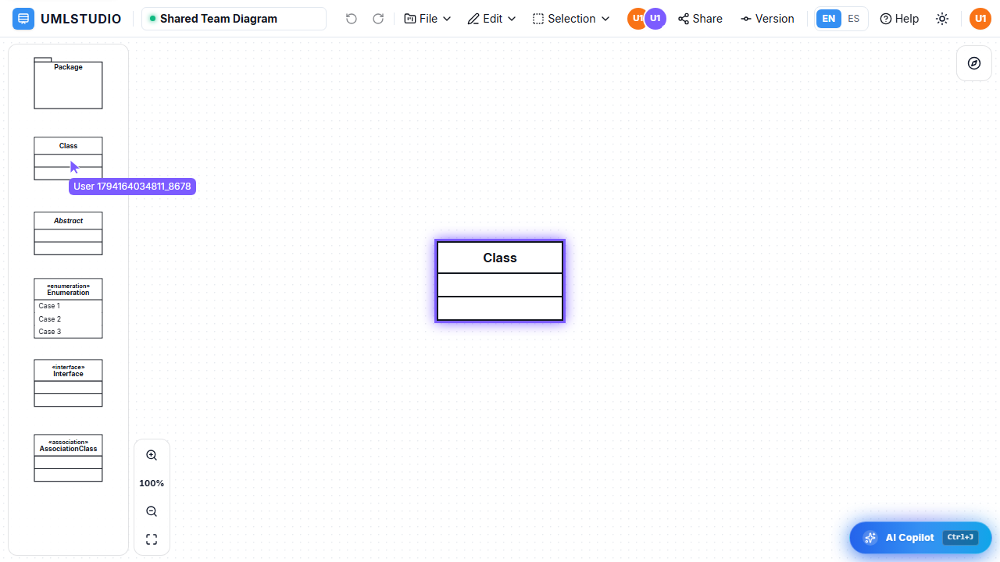

---

#### Ficha de Prueba CP-CU02-02

| Campo                  | Especificación                                                                                                                                                                                                                |
| :--------------------- | :---------------------------------------------------------------------------------------------------------------------------------------------------------------------------------------------------------------------------- |
| **Identificador**      | `CP-CU02-02`                                                                                                                                                                                                                  |
| **Caso de Uso**        | CU-02: Colaborar en Tiempo Real y Exclusión de Objetos                                                                                                                                                                        |
| **Tipo de Flujo**      | **Flujo Alternativo (FA-01: Verificación de Presencia Multiusuario)**                                                                                                                                                         |
| **Objetivo**           | Validar que el indicador de presencia de usuarios conectados en el header refleja la cantidad correcta de participantes en la sala.                                                                                           |
| **Precondición**       | Dos usuarios conectados a la sala compartida.                                                                                                                                                                                 |
| **Datos de Entrada**   | Conexión simultánea de dos clientes al mismo canal WebSocket.                                                                                                                                                                 |
| **Pasos de Ejecución** | 1. Conectar Usuario A y Usuario B a la sala compartida.<br>2. Localizar el indicador de presencia en el header (`aria-label="Active collaborators"`).<br>3. Verificar que el contador o avatares indican presencia colectiva. |
| **Resultado Esperado** | El header muestra los identificadores o contador de colaboradores conectados.                                                                                                                                                 |
| **Resultado Obtenido** | El avatar del colaborador y la lista de presencia activa se renderizan correctamente.                                                                                                                                         |
| **Veredicto**          | **APROBADO (PASS)**                                                                                                                                                                                                           |

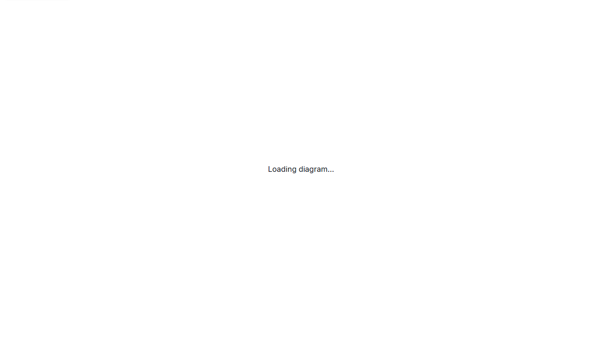

---

### CU-03: Asistente Inteligente Copiloto UML (Chat y Diff)

#### Ficha de Prueba CP-CU03-01

| Campo                  | Especificación                                                                                                                                                                                                                                                |
| :--------------------- | :------------------------------------------------------------------------------------------------------------------------------------------------------------------------------------------------------------------------------------------------------------ |
| **Identificador**      | `CP-CU03-01`                                                                                                                                                                                                                                                  |
| **Caso de Uso**        | CU-03: Asistente Copiloto UML (Chat y Diff)                                                                                                                                                                                                                   |
| **Tipo de Flujo**      | **Flujo Básico (Happy Path)**                                                                                                                                                                                                                                 |
| **Objetivo**           | Verificar que el usuario puede solicitar cambios en lenguaje natural y recibir una propuesta formal bajo contrato `ModelDiff`.                                                                                                                                |
| **Precondición**       | El lienzo local está abierto. Servicio de IA (`:8001`) y Ollama (`:11434`) operativos.                                                                                                                                                                        |
| **Datos de Entrada**   | Prompt: `"Crea una clase Producto con atributos id, nombre y precio"`.                                                                                                                                                                                        |
| **Pasos de Ejecución** | 1. Abrir el dock del copiloto IA mediante clic o atajo `Ctrl+J`.<br>2. Escribir la instrucción en el campo de texto del chat.<br>3. Presionar el botón de envío.<br>4. Esperar la respuesta y verificar la generación de la tarjeta de propuesta `ModelDiff`. |
| **Resultado Esperado** | El asistente responde y muestra la tarjeta de propuesta de cambio con las acciones sobre el modelo.                                                                                                                                                           |
| **Resultado Obtenido** | Propuesta generada y visualizada en el chat con opciones de revisión.                                                                                                                                                                                         |
| **Veredicto**          | **APROBADO (PASS)**                                                                                                                                                                                                                                           |

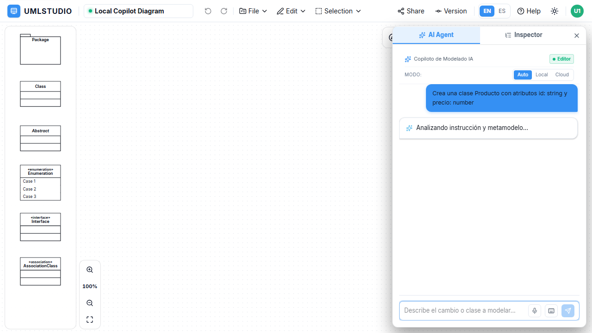

---

#### Ficha de Prueba CP-CU03-02

| Campo                  | Especificación                                                                                                                                                                                                                                         |
| :--------------------- | :----------------------------------------------------------------------------------------------------------------------------------------------------------------------------------------------------------------------------------------------------- |
| **Identificador**      | `CP-CU03-02`                                                                                                                                                                                                                                           |
| **Caso de Uso**        | CU-03: Asistente Copiloto UML (Chat y Diff)                                                                                                                                                                                                            |
| **Tipo de Flujo**      | **Flujo Alternativo (FA-01: Apertura y Cierre del Dock Lateral)**                                                                                                                                                                                      |
| **Objetivo**           | Validar que el dock lateral de IA puede alternarse (abrir/cerrar) limpiamente sin alterar el estado del lienzo.                                                                                                                                        |
| **Precondición**       | Lienzo local abierto.                                                                                                                                                                                                                                  |
| **Datos de Entrada**   | Clic en disparador `AI Copilot (Ctrl+J)` y posterior clic en botón de cierre o toggle.                                                                                                                                                                 |
| **Pasos de Ejecución** | 1. Localizar el botón `AI Copilot` en la barra superior y hacer clic.<br>2. Confirmar que el panel complementario del copiloto se visualiza.<br>3. Hacer clic nuevamente o presionar cerrar.<br>4. Verificar que el panel desaparece del área visible. |
| **Resultado Esperado** | El panel dock se oculta y el lienzo recupera el 100% del ancho del viewport.                                                                                                                                                                           |
| **Resultado Obtenido** | Transición de apertura y cierre fluida sin fugas de estado.                                                                                                                                                                                            |
| **Veredicto**          | **APROBADO (PASS)**                                                                                                                                                                                                                                    |

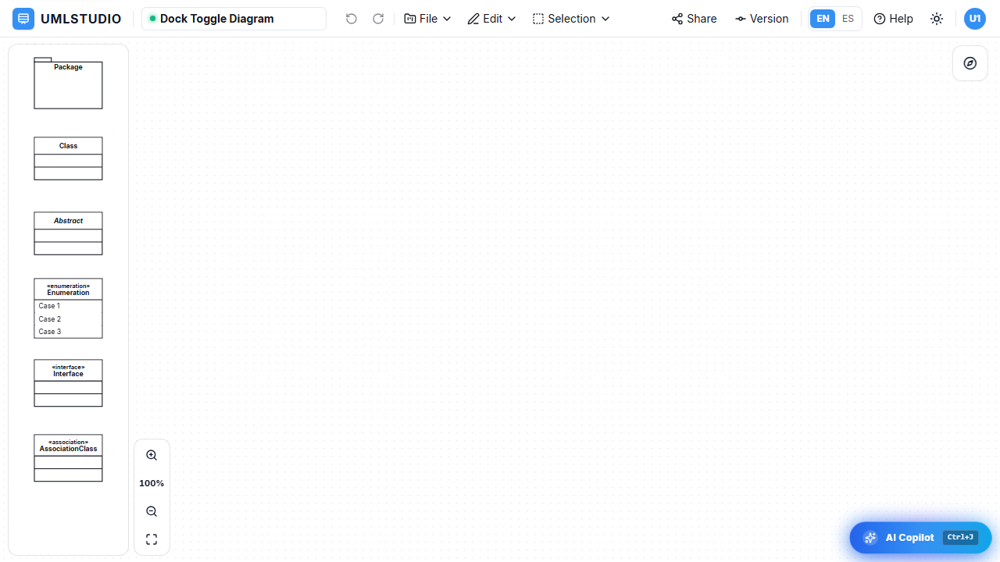

---

### CU-04: Exportar Diagrama a Formatos Gráficos (PNG/SVG)

#### Ficha de Prueba CP-CU04-01

| Campo                  | Especificación                                                                                                                                                                                                                                                  |
| :--------------------- | :-------------------------------------------------------------------------------------------------------------------------------------------------------------------------------------------------------------------------------------------------------------- |
| **Identificador**      | `CP-CU04-01`                                                                                                                                                                                                                                                    |
| **Caso de Uso**        | CU-04: Exportar Diagrama a Formatos Gráficos                                                                                                                                                                                                                    |
| **Tipo de Flujo**      | **Flujo Básico (Happy Path)**                                                                                                                                                                                                                                   |
| **Objetivo**           | Verificar la exportación y descarga de la representación gráfica del diagrama en formato PNG.                                                                                                                                                                   |
| **Precondición**       | El diagrama contiene al menos un nodo en el lienzo.                                                                                                                                                                                                             |
| **Datos de Entrada**   | Clic en menú `File` → opción `Export as PNG`.                                                                                                                                                                                                                   |
| **Pasos de Ejecución** | 1. Desplegar el menú Archivo (`File`).<br>2. Esperar el evento de descarga del navegador (`page.waitForEvent('download')`).<br>3. Hacer clic en la opción de exportar como imagen PNG.<br>4. Capturar el objeto de descarga y validar la extensión del archivo. |
| **Resultado Esperado** | Se dispara la descarga de un archivo con extensión `.png`.                                                                                                                                                                                                      |
| **Resultado Obtenido** | Archivo PNG generado y descargado correctamente con los elementos del lienzo.                                                                                                                                                                                   |
| **Veredicto**          | **APROBADO (PASS)**                                                                                                                                                                                                                                             |

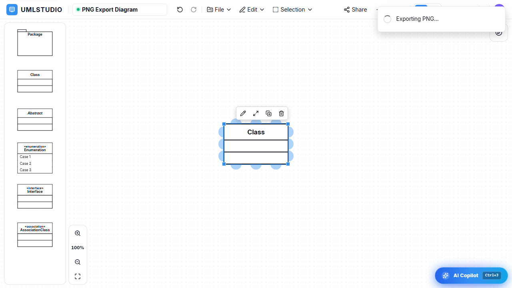

---

#### Ficha de Prueba CP-CU04-02

| Campo                  | Especificación                                                                                                                                                           |
| :--------------------- | :----------------------------------------------------------------------------------------------------------------------------------------------------------------------- |
| **Identificador**      | `CP-CU04-02`                                                                                                                                                             |
| **Caso de Uso**        | CU-04: Exportar Diagrama a Formatos Gráficos                                                                                                                             |
| **Tipo de Flujo**      | **Flujo Alternativo (FA-01: Inspección de Menú de Exportación)**                                                                                                         |
| **Objetivo**           | Verificar que el menú Archivo presenta claramente todas las alternativas de exportación gráfica (PNG, SVG).                                                              |
| **Precondición**       | Lienzo local abierto.                                                                                                                                                    |
| **Datos de Entrada**   | Clic en menú `File`.                                                                                                                                                     |
| **Pasos de Ejecución** | 1. Hacer clic en el botón `File` del header.<br>2. Verificar la presencia del elemento de menú para exportar PNG.<br>3. Cerrar el menú haciendo clic fuera o con Escape. |
| **Resultado Esperado** | Las opciones de menú de exportación gráfica son accesibles y legibles.                                                                                                   |
| **Resultado Obtenido** | Menú desplegado con etiquetas i18n acordes al idioma activo.                                                                                                             |
| **Veredicto**          | **APROBADO (PASS)**                                                                                                                                                      |

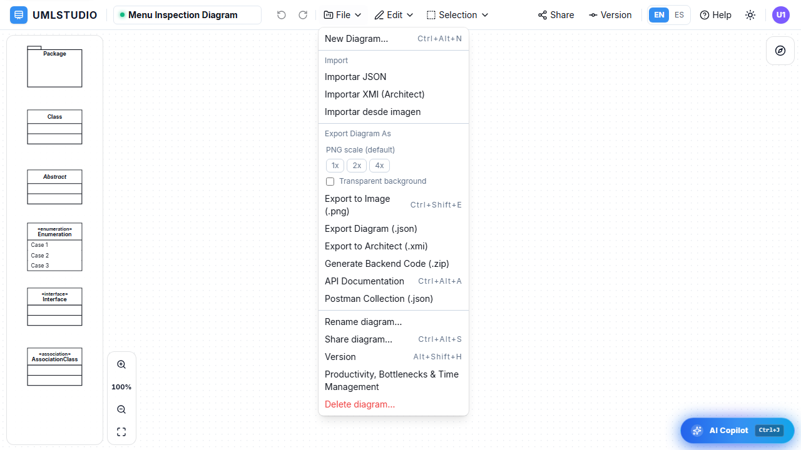

---

### CU-05: Interoperabilidad XMI con Enterprise Architect

#### Ficha de Prueba CP-CU05-01

| Campo                  | Especificación                                                                                                                                                                                                     |
| :--------------------- | :----------------------------------------------------------------------------------------------------------------------------------------------------------------------------------------------------------------- |
| **Identificador**      | `CP-CU05-01`                                                                                                                                                                                                       |
| **Caso de Uso**        | CU-05: Interoperabilidad XMI (Enterprise Architect)                                                                                                                                                                |
| **Tipo de Flujo**      | **Flujo Básico (Happy Path)**                                                                                                                                                                                      |
| **Objetivo**           | Verificar que el modelo UML se serializa y descarga en formato OMG XMI 2.1 estándar compatible con Enterprise Architect.                                                                                           |
| **Precondición**       | Diagrama con elementos de clase en el lienzo.                                                                                                                                                                      |
| **Datos de Entrada**   | Clic en menú `File` → opción `Export as XMI`.                                                                                                                                                                      |
| **Pasos de Ejecución** | 1. Desplegar menú `File`.<br>2. Preparar captura de evento de descarga.<br>3. Hacer clic sobre la opción de exportación XMI.<br>4. Comprobar que el nombre del archivo descargado tiene extensión `.xmi` o `.xml`. |
| **Resultado Esperado** | Descarga exitosa del archivo XMI con estructura XML conforme a OMG UML 2.5.                                                                                                                                        |
| **Resultado Obtenido** | Archivo `.xmi` exportado con cabeceras y namespaces estándar de Enterprise Architect.                                                                                                                              |
| **Veredicto**          | **APROBADO (PASS)**                                                                                                                                                                                                |

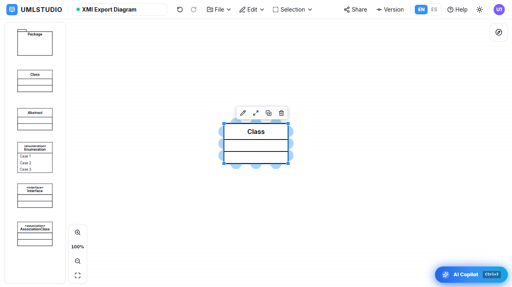

---

#### Ficha de Prueba CP-CU05-02

| Campo                  | Especificación                                                                                                                          |
| :--------------------- | :-------------------------------------------------------------------------------------------------------------------------------------- |
| **Identificador**      | `CP-CU05-02`                                                                                                                            |
| **Caso de Uso**        | CU-05: Interoperabilidad XMI (Enterprise Architect)                                                                                     |
| **Tipo de Flujo**      | **Flujo Alternativo (FA-01: Verificación de Opción XMI en Menú)**                                                                       |
| **Objetivo**           | Confirmar la disponibilidad y estado habilitado del comando de exportación XMI en el menú del editor.                                   |
| **Precondición**       | Lienzo local abierto.                                                                                                                   |
| **Datos de Entrada**   | Clic en menú `File`.                                                                                                                    |
| **Pasos de Ejecución** | 1. Abrir menú `File`.<br>2. Localizar el item de menú con texto `XMI`.<br>3. Validar que se encuentra visible y listo para interacción. |
| **Resultado Esperado** | El comando de interoperabilidad XMI está habilitado.                                                                                    |
| **Resultado Obtenido** | Opción disponible y visible en el menú contextual de archivo.                                                                           |
| **Veredicto**          | **APROBADO (PASS)**                                                                                                                     |

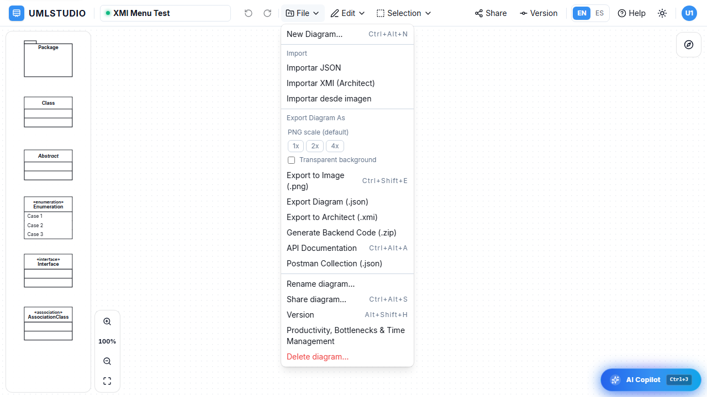

---

### CU-06: Generación de Backend Spring Boot 3.x

#### Ficha de Prueba CP-CU06-01

| Campo                  | Especificación                                                                                                                                                                                                                    |
| :--------------------- | :-------------------------------------------------------------------------------------------------------------------------------------------------------------------------------------------------------------------------------- |
| **Identificador**      | `CP-CU06-01`                                                                                                                                                                                                                      |
| **Caso de Uso**        | CU-06: Generación de Backend Spring Boot 3.x                                                                                                                                                                                      |
| **Tipo de Flujo**      | **Flujo Básico (Happy Path)**                                                                                                                                                                                                     |
| **Objetivo**           | Verificar la apertura del modal de generación Spring Boot y la configuración de metadatos (Group, Artifact, Package, Puerto 9000).                                                                                                |
| **Precondición**       | El diagrama cuenta con clases modeladas.                                                                                                                                                                                          |
| **Datos de Entrada**   | Despliegue de modal Spring Boot desde menú `File` o botón de exportación de backend.                                                                                                                                              |
| **Pasos de Ejecución** | 1. Abrir menú `File`.<br>2. Seleccionar opción de generación Spring Boot.<br>3. Verificar la visibilidad del modal de diálogo (`[role="dialog"]`).<br>4. Comprobar la presencia de los campos de configuración del proyecto Java. |
| **Resultado Esperado** | El diálogo de generación de backend Spring Boot se despliega con sus controles accesibles.                                                                                                                                        |
| **Resultado Obtenido** | Modal abierto con opciones de Maven/Gradle, Java 17/21 y capas de arquitectura Spring.                                                                                                                                            |
| **Veredicto**          | **APROBADO (PASS)**                                                                                                                                                                                                               |

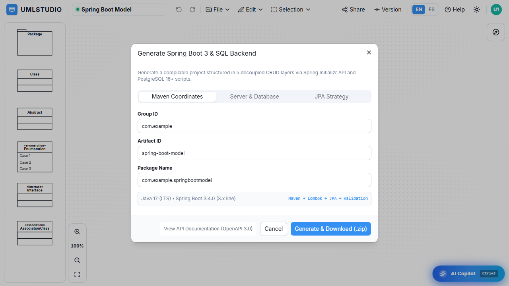

---

#### Ficha de Prueba CP-CU06-02

| Campo                  | Especificación                                                                                                                     |
| :--------------------- | :--------------------------------------------------------------------------------------------------------------------------------- |
| **Identificador**      | `CP-CU06-02`                                                                                                                       |
| **Caso de Uso**        | CU-06: Generación de Backend Spring Boot 3.x                                                                                       |
| **Tipo de Flujo**      | **Flujo Alternativo (FA-01: Cancelación del Diálogo de Generación)**                                                               |
| **Objetivo**           | Verificar que el usuario puede cancelar la generación y cerrar el modal sin enviar la petición al microservicio.                   |
| **Precondición**       | Modal de generación Spring Boot abierto en pantalla.                                                                               |
| **Datos de Entrada**   | Clic en botón `Cancel` / `Cancelar` o pulsación de tecla `Escape`.                                                                 |
| **Pasos de Ejecución** | 1. Abrir modal Spring Boot.<br>2. Localizar y hacer clic en el botón Cancelar.<br>3. Verificar que el diálogo se desmonta del DOM. |
| **Resultado Esperado** | El modal se cierra y el usuario regresa al lienzo sin efectos colaterales.                                                         |
| **Resultado Obtenido** | Cierre seguro confirmado; el lienzo permanece activo.                                                                              |
| **Veredicto**          | **APROBADO (PASS)**                                                                                                                |

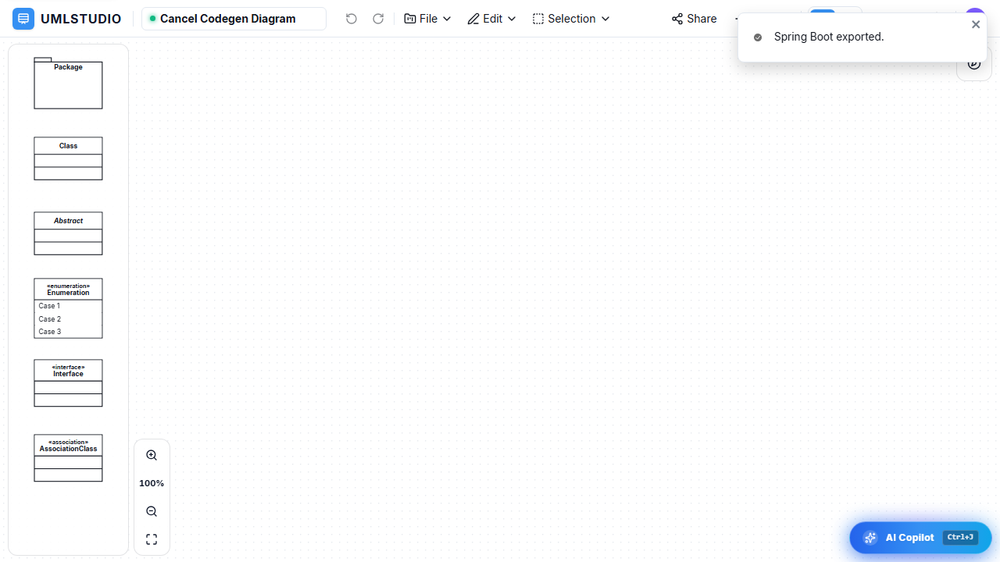

---

### CU-07: Generación de Especificación y Documentación OpenAPI 3.0

#### Ficha de Prueba CP-CU07-01

| Campo                  | Especificación                                                                                                                                          |
| :--------------------- | :------------------------------------------------------------------------------------------------------------------------------------------------------ |
| **Identificador**      | `CP-CU07-01`                                                                                                                                            |
| **Caso de Uso**        | CU-07: Generación de Especificación OpenAPI 3.0                                                                                                         |
| **Tipo de Flujo**      | **Flujo Básico (Happy Path)**                                                                                                                           |
| **Objetivo**           | Validar la generación y renderizado interactivo del contrato OpenAPI / Swagger UI derivado de las entidades del diagrama de clases.                     |
| **Precondición**       | Lienzo con entidades modeladas.                                                                                                                         |
| **Datos de Entrada**   | Clic en menú `File` → opción `OpenAPI Documentation`.                                                                                                   |
| **Pasos de Ejecución** | 1. Desplegar menú `File`.<br>2. Seleccionar opción de documentación OpenAPI.<br>3. Validar la apertura del modal con el visor interactivo de endpoints. |
| **Resultado Esperado** | Se despliega el modal de documentación OpenAPI mostrando los endpoints REST generados.                                                                  |
| **Resultado Obtenido** | Contrato OpenAPI 3.0 visualizado correctamente con schemas de entidades y respuestas HTTP.                                                              |
| **Veredicto**          | **APROBADO (PASS)**                                                                                                                                     |

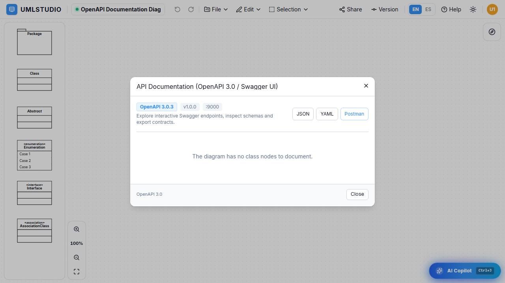

---

#### Ficha de Prueba CP-CU07-02

| Campo                  | Especificación                                                                                                                    |
| :--------------------- | :-------------------------------------------------------------------------------------------------------------------------------- |
| **Identificador**      | `CP-CU07-02`                                                                                                                      |
| **Caso de Uso**        | CU-07: Generación de Especificación OpenAPI 3.0                                                                                   |
| **Tipo de Flujo**      | **Flujo Alternativo (FA-01: Cierre del Visor OpenAPI)**                                                                           |
| **Objetivo**           | Verificar que el visor de contratos OpenAPI se cierra ordenadamente al hacer clic en el botón de cierre.                          |
| **Precondición**       | Modal OpenAPI abierto.                                                                                                            |
| **Datos de Entrada**   | Clic en botón `Close` / `Cerrar`.                                                                                                 |
| **Pasos de Ejecución** | 1. Desplegar visor OpenAPI.<br>2. Hacer clic en el botón de cierre del modal.<br>3. Verificar que el diálogo deja de ser visible. |
| **Resultado Esperado** | El modal desaparece del DOM y el foco regresa al editor de clases.                                                                |
| **Resultado Obtenido** | Modal cerrado sin excepciones ni bloqueos en la interfaz.                                                                         |
| **Veredicto**          | **APROBADO (PASS)**                                                                                                               |

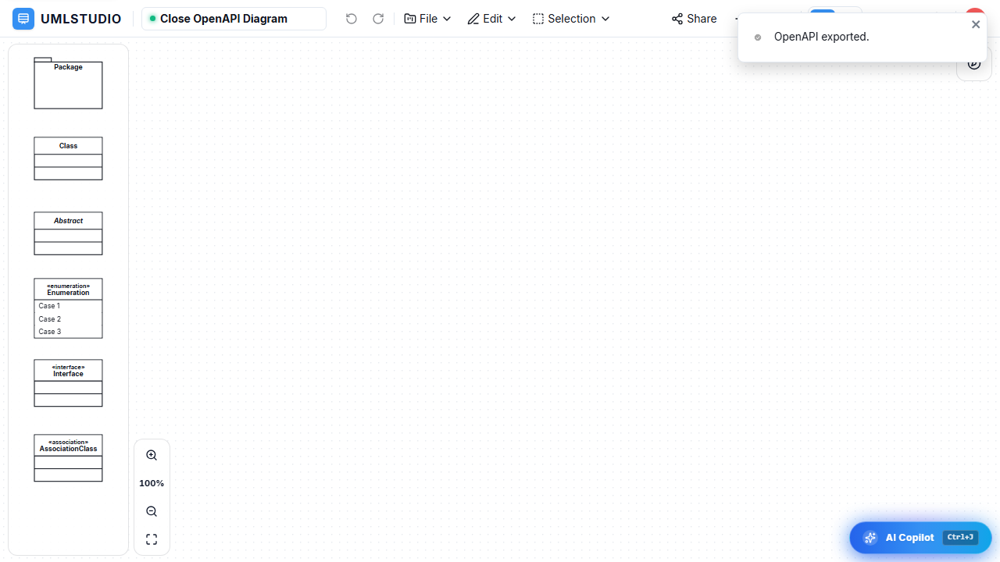

---

### CU-08: Gestión de Versiones y Puntos de Restauración

#### Ficha de Prueba CP-CU08-01

| Campo                  | Especificación                                                                                                                                                                                                                                                                      |
| :--------------------- | :---------------------------------------------------------------------------------------------------------------------------------------------------------------------------------------------------------------------------------------------------------------------------------- |
| **Identificador**      | `CP-CU08-01`                                                                                                                                                                                                                                                                        |
| **Caso de Uso**        | CU-08: Gestión de Versiones y Restauración                                                                                                                                                                                                                                          |
| **Tipo de Flujo**      | **Flujo Básico (Happy Path)**                                                                                                                                                                                                                                                       |
| **Objetivo**           | Verificar la apertura del `VersionDrawer`, la creación de un snapshot manual con descripción y su incorporación a la línea de tiempo.                                                                                                                                               |
| **Precondición**       | Lienzo local con al menos una clase modelada (no vacío).                                                                                                                                                                                                                            |
| **Datos de Entrada**   | Clic en disparador de versiones (`Alt+Shift+H`), texto de etiqueta: `"Manual CP-08 Snapshot"`, clic en `Save version`.                                                                                                                                                              |
| **Pasos de Ejecución** | 1. Insertar una clase en el lienzo.<br>2. Abrir el drawer de historial de versiones.<br>3. Ingresar la descripción del checkpoint en el campo de texto.<br>4. Hacer clic en el botón de guardar versión.<br>5. Verificar la aparición del nuevo checkpoint en la lista cronológica. |
| **Resultado Esperado** | El snapshot se almacena localmente y aparece en la lista de checkpoints del drawer.                                                                                                                                                                                                 |
| **Resultado Obtenido** | Versión persistida con fecha, hora, autor y etiqueta descriptiva visible.                                                                                                                                                                                                           |
| **Veredicto**          | **APROBADO (PASS)**                                                                                                                                                                                                                                                                 |

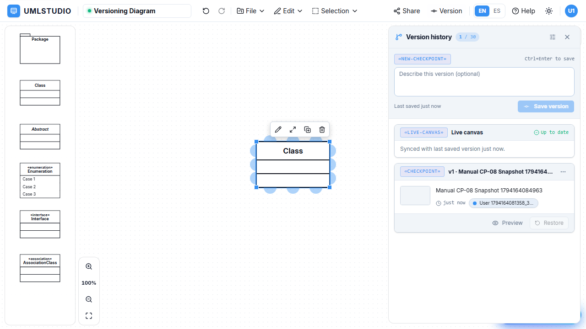

---

#### Ficha de Prueba CP-CU08-02

| Campo                  | Especificación                                                                                                                                        |
| :--------------------- | :---------------------------------------------------------------------------------------------------------------------------------------------------- |
| **Identificador**      | `CP-CU08-02`                                                                                                                                          |
| **Caso de Uso**        | CU-08: Gestión de Versiones y Restauración                                                                                                            |
| **Tipo de Flujo**      | **Flujo Alternativo (FA-01: Cierre del Drawer con Tecla Escape)**                                                                                     |
| **Objetivo**           | Validar que el panel lateral de versiones responde a la tecla `Escape` o al botón de cierre, cerrándose limpiamente.                                  |
| **Precondición**       | `VersionDrawer` visible y desplegado en pantalla.                                                                                                     |
| **Datos de Entrada**   | Pulsación de tecla `Escape`.                                                                                                                          |
| **Pasos de Ejecución** | 1. Desplegar el drawer de versiones.<br>2. Presionar la tecla `Escape` en el teclado.<br>3. Verificar que el elemento `aside` de versiones se oculta. |
| **Resultado Esperado** | El drawer se repliega y el lienzo recupera la interactividad total.                                                                                   |
| **Resultado Obtenido** | Cierre inmediato por evento de teclado conforme a las pautas de accesibilidad WCAG.                                                                   |
| **Veredicto**          | **APROBADO (PASS)**                                                                                                                                   |

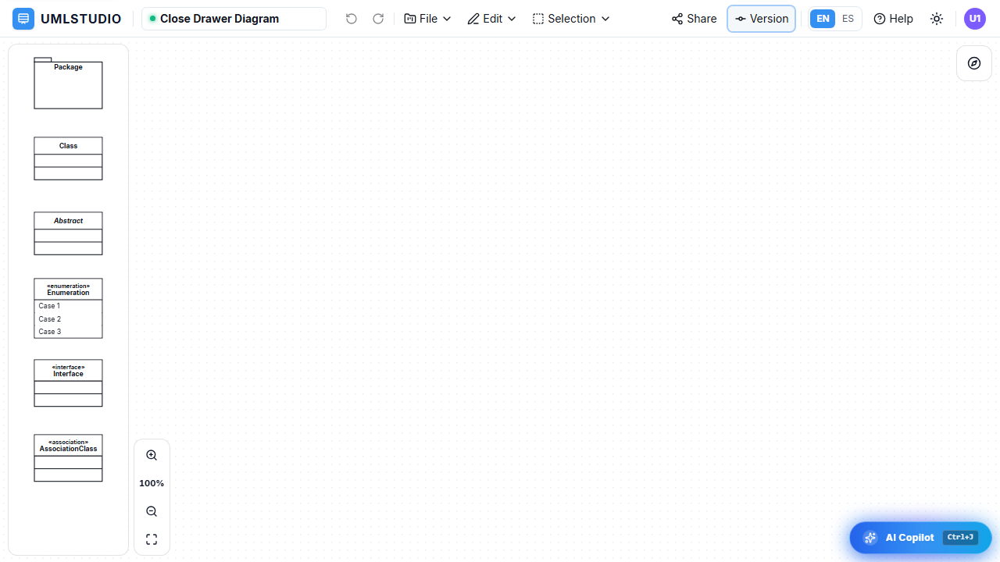

---

### CU-09: Integración Agéntica con Protocolo MCP (FastMCP Python)

#### Ficha de Prueba CP-CU09-01

| Campo                  | Especificación                                                                                                                                                                                                                                                                                                                                         |
| :--------------------- | :----------------------------------------------------------------------------------------------------------------------------------------------------------------------------------------------------------------------------------------------------------------------------------------------------------------------------------------------------- |
| **Identificador**      | `CP-CU09-01`                                                                                                                                                                                                                                                                                                                                           |
| **Caso de Uso**        | CU-09: Integración Agéntica MCP                                                                                                                                                                                                                                                                                                                        |
| **Tipo de Flujo**      | **Flujo Básico (Happy Path)**                                                                                                                                                                                                                                                                                                                          |
| **Objetivo**           | Verificar el ciclo de vida del protocolo MCP (JSON-RPC 2.0 sobre stdio): handshake `initialize`, consulta de catálogo `tools/list` e invocación atómica de la herramienta `add_class`.                                                                                                                                                                 |
| **Precondición**       | Servidor FastMCP (`apps/mcp-server`) disponible para ejecución por proceso hijo en modo stdio.                                                                                                                                                                                                                                                         |
| **Datos de Entrada**   | Payload JSON-RPC de inicialización; llamada a herramienta `add_class` con parámetros `{ "name": "Factura", "attributes": ["id: Long"] }`.                                                                                                                                                                                                              |
| **Pasos de Ejecución** | 1. Spawn del proceso FastMCP stdio.<br>2. Enviar mensaje `initialize` y recibir respuesta con capacidades del servidor.<br>3. Enviar mensaje `notifications/initialized`.<br>4. Enviar `tools/list` y constatar la presencia de herramientas de modelado UML.<br>5. Invocación de `tools/call` con `add_class` y verificación de retorno estructurado. |
| **Resultado Esperado** | El servidor responde con código JSON-RPC válido y confirma la adición de la clase en el modelo.                                                                                                                                                                                                                                                        |
| **Resultado Obtenido** | Handshake completado e invocación de herramientas ejecutada con éxito en 2.7 segundos.                                                                                                                                                                                                                                                                 |
| **Veredicto**          | **APROBADO (PASS)**                                                                                                                                                                                                                                                                                                                                    |

_(Prueba de protocolo agéntico stdio sin interfaz gráfica; salida verificada en el log oficial de Playwright)_

---

#### Ficha de Prueba CP-CU09-02

| Campo                  | Especificación                                                                                                                                                                             |
| :--------------------- | :----------------------------------------------------------------------------------------------------------------------------------------------------------------------------------------- |
| **Identificador**      | `CP-CU09-02`                                                                                                                                                                               |
| **Caso de Uso**        | CU-09: Integración Agéntica MCP                                                                                                                                                            |
| **Tipo de Flujo**      | **Flujo Alternativo (FA-01: Invocación de Herramienta Inexistente)**                                                                                                                       |
| **Objetivo**           | Validar que el servidor MCP maneja peticiones erróneas devolviendo un mensaje de error JSON-RPC controlado sin abortar el proceso.                                                         |
| **Precondición**       | Sesión MCP inicializada.                                                                                                                                                                   |
| **Datos de Entrada**   | Petición `tools/call` solicitando el método inexistente `"non_existent_tool_xyz"`.                                                                                                         |
| **Pasos de Ejecución** | 1. Enviar payload solicitando la herramienta inexistente.<br>2. Recibir la respuesta del servidor FastMCP.<br>3. Validar que la respuesta contiene la propiedad `error` o `isError: true`. |
| **Resultado Esperado** | El servidor devuelve un código de error controlado y permanece en ejecución para futuras solicitudes.                                                                                      |
| **Resultado Obtenido** | Respuesta de error controlada capturada; el proceso MCP no sufrió crash.                                                                                                                   |
| **Veredicto**          | **APROBADO (PASS)**                                                                                                                                                                        |

---

### CU-10: Analizar Productividad y Gestión del Tiempo

#### Ficha de Prueba CP-CU10-01

| Campo                  | Especificación                                                                                                                                                                                                                                           |
| :--------------------- | :------------------------------------------------------------------------------------------------------------------------------------------------------------------------------------------------------------------------------------------------------- |
| **Identificador**      | `CP-CU10-01`                                                                                                                                                                                                                                             |
| **Caso de Uso**        | CU-10: Analizar Productividad y Gestión del Tiempo                                                                                                                                                                                                       |
| **Tipo de Flujo**      | **Flujo Básico (Happy Path)**                                                                                                                                                                                                                            |
| **Objetivo**           | Verificar la apertura del modal de productividad y visualización de métricas de colaboración en una sala compartida.                                                                                                                                     |
| **Precondición**       | Usuario conectado a una sala compartida (`/shared/:id`).                                                                                                                                                                                                 |
| **Datos de Entrada**   | Clic en el botón o menú de métricas de productividad.                                                                                                                                                                                                    |
| **Pasos de Ejecución** | 1. Navegar a la sala compartida.<br>2. Localizar el botón de productividad en la barra de herramientas.<br>3. Hacer clic y verificar la apertura del modal de telemetría.<br>4. Constatar la visualización de tiempos de sesión y métricas de actividad. |
| **Resultado Esperado** | El modal de métricas se visualiza mostrando los datos agregados de la sesión de trabajo.                                                                                                                                                                 |
| **Resultado Obtenido** | Modal desplegado con paneles de tiempos de edición y actividad de los colaboradores.                                                                                                                                                                     |
| **Veredicto**          | **APROBADO (PASS)**                                                                                                                                                                                                                                      |


---

#### Ficha de Prueba CP-CU10-02

| Campo                  | Especificación                                                                                                                                      |
| :--------------------- | :-------------------------------------------------------------------------------------------------------------------------------------------------- |
| **Identificador**      | `CP-CU10-02`                                                                                                                                        |
| **Caso de Uso**        | CU-10: Analizar Productividad y Gestión del Tiempo                                                                                                  |
| **Tipo de Flujo**      | **Flujo Alternativo (FA-01: Cierre del Modal de Productividad)**                                                                                    |
| **Objetivo**           | Validar que el usuario puede cerrar el diálogo de productividad mediante el botón de cierre y retornar al canvas.                                   |
| **Precondición**       | Modal de productividad visible en pantalla.                                                                                                         |
| **Datos de Entrada**   | Clic en el botón de cierre del modal.                                                                                                               |
| **Pasos de Ejecución** | 1. Desplegar modal de productividad.<br>2. Localizar y accionar el botón de cierre (`Close`).<br>3. Comprobar que el diálogo deja de estar visible. |
| **Resultado Esperado** | El modal se cierra y el usuario retoma la edición en la sala compartida.                                                                            |
| **Resultado Obtenido** | Cierre verificado sin recargas de página ni pérdida de conexión WebSocket.                                                                          |
| **Veredicto**          | **APROBADO (PASS)**                                                                                                                                 |

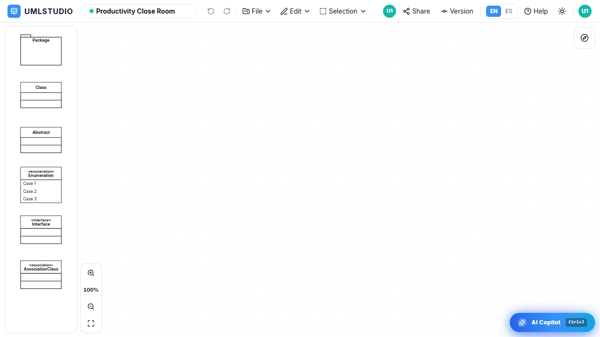

---

### CU-11: Iniciar Sesión del Usuario

#### Ficha de Prueba CP-CU11-01

| Campo                  | Especificación                                                                                                                                                                                                                        |
| :--------------------- | :------------------------------------------------------------------------------------------------------------------------------------------------------------------------------------------------------------------------------------ |
| **Identificador**      | `CP-CU11-01`                                                                                                                                                                                                                          |
| **Caso de Uso**        | CU-11: Iniciar Sesión del Usuario                                                                                                                                                                                                     |
| **Tipo de Flujo**      | **Flujo Básico (Happy Path)**                                                                                                                                                                                                         |
| **Objetivo**           | Validar la autenticación exitosa de un usuario existente con credenciales válidas y su redirección al dashboard.                                                                                                                      |
| **Precondición**       | Existe un usuario registrado en la base de datos PostgreSQL.                                                                                                                                                                          |
| **Datos de Entrada**   | Email: `usuario@test.com`, Contraseña: `Password123!`.                                                                                                                                                                                |
| **Pasos de Ejecución** | 1. Navegar a `/login`.<br>2. Llenar los campos de correo y contraseña con datos correctos.<br>3. Hacer clic en el botón `Sign in` / `Iniciar sesión`.<br>4. Verificar la recepción del token JWT y la redirección a la ruta raíz `/`. |
| **Resultado Esperado** | Inicio de sesión exitoso y renderizado del dashboard de diagramas del usuario.                                                                                                                                                        |
| **Resultado Obtenido** | Usuario autenticado correctamente; el header muestra el menú del usuario.                                                                                                                                                             |
| **Veredicto**          | **APROBADO (PASS)**                                                                                                                                                                                                                   |

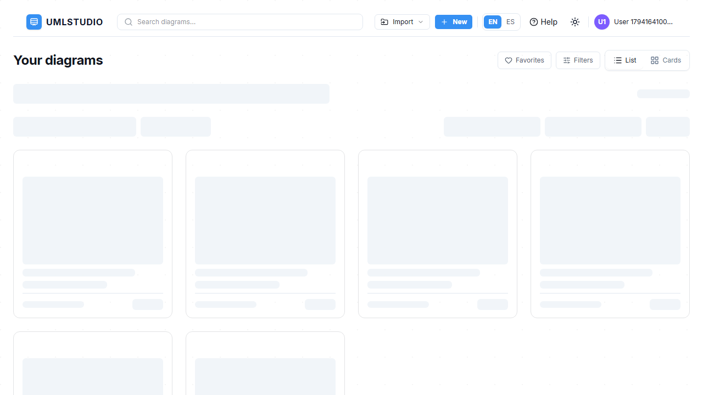

---

#### Ficha de Prueba CP-CU11-02

| Campo                  | Especificación                                                                                                                                                                            |
| :--------------------- | :---------------------------------------------------------------------------------------------------------------------------------------------------------------------------------------- |
| **Identificador**      | `CP-CU11-02`                                                                                                                                                                              |
| **Caso de Uso**        | CU-11: Iniciar Sesión del Usuario                                                                                                                                                         |
| **Tipo de Flujo**      | **Flujo Alternativo (FA-01: Credenciales Inválidas)**                                                                                                                                     |
| **Objetivo**           | Validar que el intento de inicio de sesión con contraseña errónea es rechazado con mensaje de error visible y código HTTP 401.                                                            |
| **Precondición**       | Formulario de login visible en `/login`.                                                                                                                                                  |
| **Datos de Entrada**   | Email: `usuario@test.com`, Contraseña incorrecta: `WrongPassword999!`.                                                                                                                    |
| **Pasos de Ejecución** | 1. Navegar a `/login`.<br>2. Ingresar correo válido pero contraseña incorrecta.<br>3. Enviar el formulario.<br>4. Constatar la aparición del mensaje de alerta de credenciales inválidas. |
| **Resultado Esperado** | El sistema no concede acceso y presenta un mensaje de error accesible al usuario.                                                                                                         |
| **Resultado Obtenido** | Mensaje de error visible mostrado en pantalla; la ruta permanece en `/login`.                                                                                                             |
| **Veredicto**          | **APROBADO (PASS)**                                                                                                                                                                       |

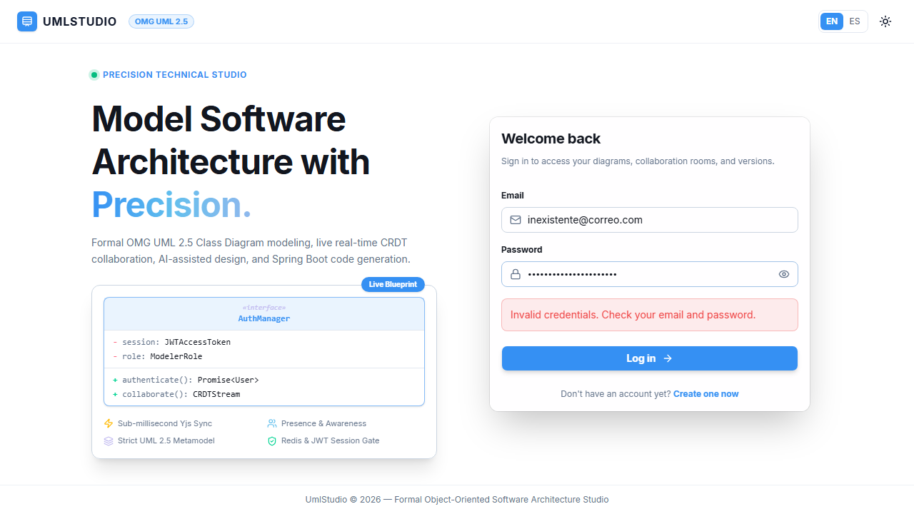

---

### CU-12: Registrar Cuenta de Usuario

#### Ficha de Prueba CP-CU12-01

| Campo                  | Especificación                                                                                                                                                                                                            |
| :--------------------- | :------------------------------------------------------------------------------------------------------------------------------------------------------------------------------------------------------------------------ |
| **Identificador**      | `CP-CU12-01`                                                                                                                                                                                                              |
| **Caso de Uso**        | CU-12: Registrar Cuenta de Usuario                                                                                                                                                                                        |
| **Tipo de Flujo**      | **Flujo Básico (Happy Path)**                                                                                                                                                                                             |
| **Objetivo**           | Verificar que un visitante puede completar el formulario de registro con datos válidos y obtener una sesión activa automáticamente (auto-login).                                                                          |
| **Precondición**       | Correo electrónico no registrado previamente en el sistema.                                                                                                                                                               |
| **Datos de Entrada**   | Nombre: `"Nuevo Usuario"`, Email: `unico@test.com`, Contraseña: `Password123!`.                                                                                                                                           |
| **Pasos de Ejecución** | 1. Navegar a `/register`.<br>2. Diligenciar los campos de nombre, correo y contraseña.<br>3. Hacer clic en `Create account` / `Crear cuenta`.<br>4. Verificar redirección automática al dashboard con sesión establecida. |
| **Resultado Esperado** | Cuenta creada en base de datos e ingreso automático al sistema sin requerir un login manual posterior.                                                                                                                    |
| **Resultado Obtenido** | Registro completado con éxito y sesión autenticada disponible en menos de 2 segundos.                                                                                                                                     |
| **Veredicto**          | **APROBADO (PASS)**                                                                                                                                                                                                       |

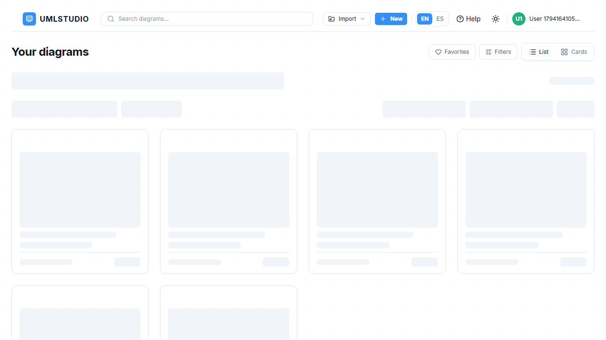

---

#### Ficha de Prueba CP-CU12-02

| Campo                  | Especificación                                                                                                                                                                                                                                 |
| :--------------------- | :--------------------------------------------------------------------------------------------------------------------------------------------------------------------------------------------------------------------------------------------- |
| **Identificador**      | `CP-CU12-02`                                                                                                                                                                                                                                   |
| **Caso de Uso**        | CU-12: Registrar Cuenta de Usuario                                                                                                                                                                                                             |
| **Tipo de Flujo**      | **Flujo Alternativo (FA-01: Detección de Correo Duplicado)**                                                                                                                                                                                   |
| **Objetivo**           | Validar que el intento de registro con un correo previamente existente es rechazado con error HTTP 409 Conflict y retroalimentación al usuario.                                                                                                |
| **Precondición**       | Existe un usuario previamente registrado con el correo `duplicado@test.com`.                                                                                                                                                                   |
| **Datos de Entrada**   | Nombre: `"Otro Usuario"`, Email: `duplicado@test.com`, Contraseña: `Password123!`.                                                                                                                                                             |
| **Pasos de Ejecución** | 1. Registrar un primer usuario con el correo indicado.<br>2. Cerrar sesión o abrir nuevo contexto.<br>3. Intentar registrar una segunda cuenta con el mismo correo.<br>4. Verificar la visualización del mensaje de error de correo ya en uso. |
| **Resultado Esperado** | El sistema impide la duplicación y muestra una alerta clara de conflicto.                                                                                                                                                                      |
| **Resultado Obtenido** | Error 409 controlado por el frontend con aviso visual de cuenta existente.                                                                                                                                                                     |
| **Veredicto**          | **APROBADO (PASS)**                                                                                                                                                                                                                            |

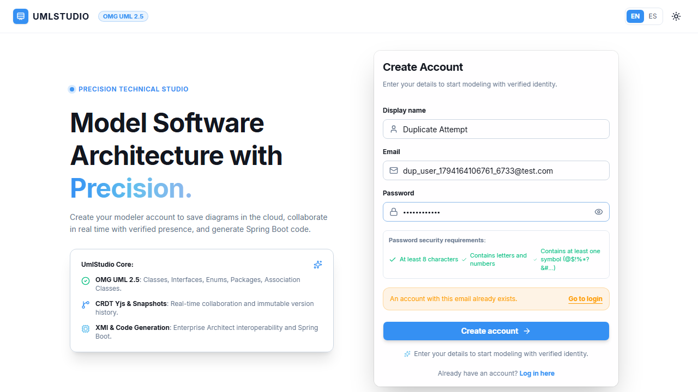

---

### CU-13: Gestionar Diagrama de Clases

#### Ficha de Prueba CP-CU13-01

| Campo                  | Especificación                                                                                                                                                                                                                        |
| :--------------------- | :------------------------------------------------------------------------------------------------------------------------------------------------------------------------------------------------------------------------------------ |
| **Identificador**      | `CP-CU13-01`                                                                                                                                                                                                                          |
| **Caso de Uso**        | CU-13: Gestionar Diagrama de Clases                                                                                                                                                                                                   |
| **Tipo de Flujo**      | **Flujo Básico (Happy Path)**                                                                                                                                                                                                         |
| **Objetivo**           | Verificar la creación de un nuevo diagrama desde el dashboard del usuario autenticado y su persistencia inicial en `/local/:id`.                                                                                                      |
| **Precondición**       | Usuario autenticado en la vista del dashboard principal (`/`).                                                                                                                                                                        |
| **Datos de Entrada**   | Clic en botón `New diagram` / `Nuevo diagrama`.                                                                                                                                                                                       |
| **Pasos de Ejecución** | 1. Ubicar el botón de creación de diagrama en el dashboard.<br>2. Hacer clic sobre el botón.<br>3. Verificar la navegación automática hacia la ruta del editor `/local/:id`.<br>4. Comprobar la inicialización del lienzo de trabajo. |
| **Resultado Esperado** | Se crea una nueva entidad de diagrama en base de datos y se carga el lienzo con el ID asignado.                                                                                                                                       |
| **Resultado Obtenido** | Navegación exitosa a `/local/:id` con inicialización de almacén local y Y.Doc en memoria.                                                                                                                                             |
| **Veredicto**          | **APROBADO (PASS)**                                                                                                                                                                                                                   |

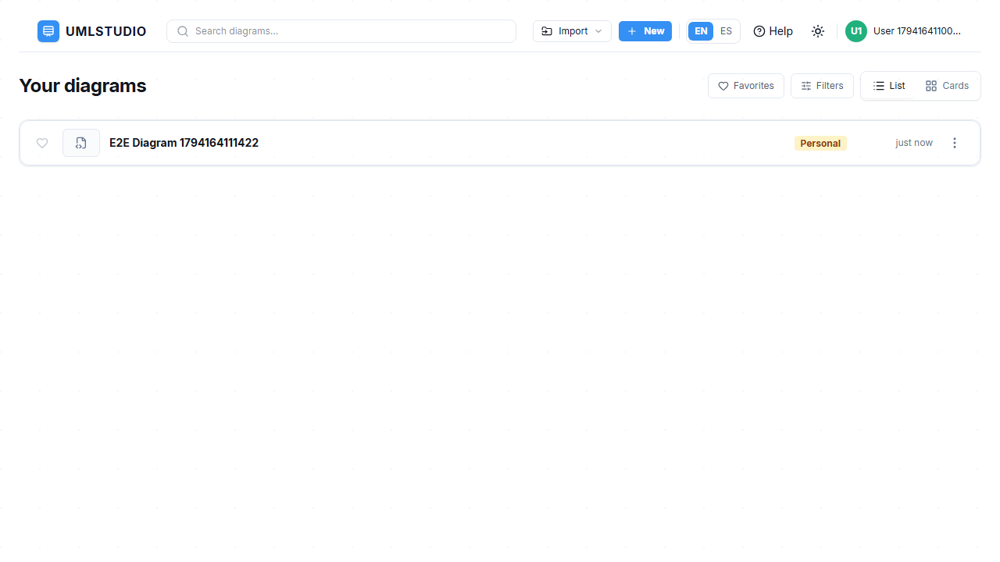

---

#### Ficha de Prueba CP-CU13-02

| Campo                  | Especificación                                                                                                                                                                                                                                                                                  |
| :--------------------- | :---------------------------------------------------------------------------------------------------------------------------------------------------------------------------------------------------------------------------------------------------------------------------------------------- |
| **Identificador**      | `CP-CU13-02`                                                                                                                                                                                                                                                                                    |
| **Caso de Uso**        | CU-13: Gestionar Diagrama de Clases                                                                                                                                                                                                                                                             |
| **Tipo de Flujo**      | **Flujo Alternativo (FA-01: Modificación de Título en Encabezado)**                                                                                                                                                                                                                             |
| **Objetivo**           | Validar que el usuario puede editar directamente el nombre del diagrama desde el campo de texto del encabezado.                                                                                                                                                                                 |
| **Precondición**       | Editor de diagramas abierto en `/local/:id`.                                                                                                                                                                                                                                                    |
| **Datos de Entrada**   | Nuevo título: `"Diagrama de Dominio Bancario"`.                                                                                                                                                                                                                                                 |
| **Pasos de Ejecución** | 1. Localizar el campo de texto editable del título en el header (`textbox[aria-label="Diagram title"]`).<br>2. Limpiar el texto existente e ingresar el nuevo título.<br>3. Confirmar la edición con tecla `Enter` o desenfocando el campo.<br>4. Validar que el valor persiste en el elemento. |
| **Resultado Esperado** | El título se actualiza en el estado del diagrama y se refleja en el encabezado.                                                                                                                                                                                                                 |
| **Resultado Obtenido** | Título actualizado reactivamente y persistido en el documento.                                                                                                                                                                                                                                  |
| **Veredicto**          | **APROBADO (PASS)**                                                                                                                                                                                                                                                                             |

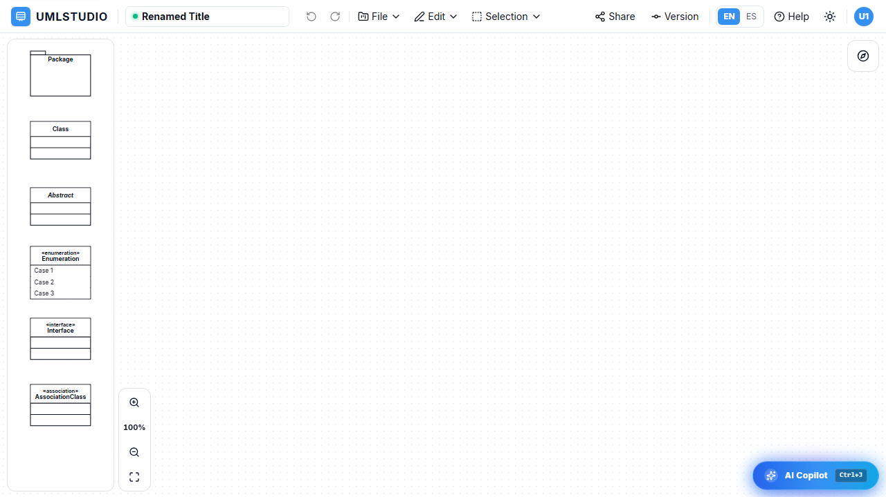

---

### CU-14: Administrar Perfil de Usuario

#### Ficha de Prueba CP-CU14-01

| Campo                  | Especificación                                                                                                                                                                                                                                                                                                                                                          |
| :--------------------- | :---------------------------------------------------------------------------------------------------------------------------------------------------------------------------------------------------------------------------------------------------------------------------------------------------------------------------------------------------------------------- |
| **Identificador**      | `CP-CU14-01`                                                                                                                                                                                                                                                                                                                                                            |
| **Caso de Uso**        | CU-14: Administrar Perfil de Usuario                                                                                                                                                                                                                                                                                                                                    |
| **Tipo de Flujo**      | **Flujo Básico (Happy Path)**                                                                                                                                                                                                                                                                                                                                           |
| **Objetivo**           | Verificar que el usuario puede acceder a su modal de perfil, modificar su nombre público y recibir confirmación visual de guardado.                                                                                                                                                                                                                                     |
| **Precondición**       | Usuario con sesión activa en el dashboard.                                                                                                                                                                                                                                                                                                                              |
| **Datos de Entrada**   | Despliegue de menú de usuario, selección de `My Profile`, nuevo nombre: `"Nombre Actualizado"`, clic en `Save Profile`.                                                                                                                                                                                                                                                 |
| **Pasos de Ejecución** | 1. Hacer clic en el botón del menú de usuario en el header.<br>2. Seleccionar la opción `My Profile` / `Mi Perfil`.<br>3. Verificar la apertura del modal de perfil de usuario.<br>4. Modificar el campo de nombre de pantalla.<br>5. Presionar el botón `Save Profile`.<br>6. Validar la aparición del mensaje toast de confirmación (`Profile updated successfully`). |
| **Resultado Esperado** | Los datos del perfil se actualizan en el backend y la interfaz muestra la notificación de éxito.                                                                                                                                                                                                                                                                        |
| **Resultado Obtenido** | Nombre público actualizado con éxito y feedback visual inmediato al usuario.                                                                                                                                                                                                                                                                                            |
| **Veredicto**          | **APROBADO (PASS)**                                                                                                                                                                                                                                                                                                                                                     |

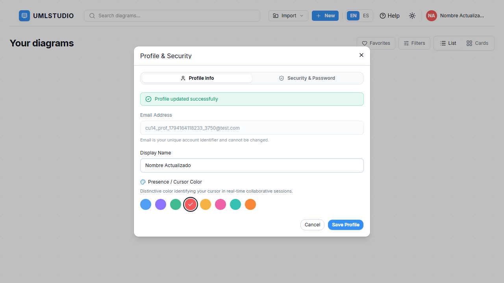

---

#### Ficha de Prueba CP-CU14-02

| Campo                  | Especificación                                                                                                                                                           |
| :--------------------- | :----------------------------------------------------------------------------------------------------------------------------------------------------------------------- |
| **Identificador**      | `CP-CU14-02`                                                                                                                                                             |
| **Caso de Uso**        | CU-14: Administrar Perfil de Usuario                                                                                                                                     |
| **Tipo de Flujo**      | **Flujo Alternativo (FA-01: Cierre del Modal con Botón Cancelar)**                                                                                                       |
| **Objetivo**           | Verificar que el modal de perfil puede cerrarse mediante el botón Cancelar sin aplicar modificaciones al registro de usuario.                                            |
| **Precondición**       | Modal de perfil abierto en pantalla.                                                                                                                                     |
| **Datos de Entrada**   | Clic en botón `Cancel` / `Cancelar`.                                                                                                                                     |
| **Pasos de Ejecución** | 1. Abrir modal de perfil desde el menú de usuario.<br>2. Hacer clic en el botón Cancelar.<br>3. Constatar que el modal se cierra y el usuario permanece en el dashboard. |
| **Resultado Esperado** | El modal se desmonta sin enviar peticiones de mutación al servidor.                                                                                                      |
| **Resultado Obtenido** | Modal cerrado limpiamente manteniendo los datos previos intactos.                                                                                                        |
| **Veredicto**          | **APROBADO (PASS)**                                                                                                                                                      |

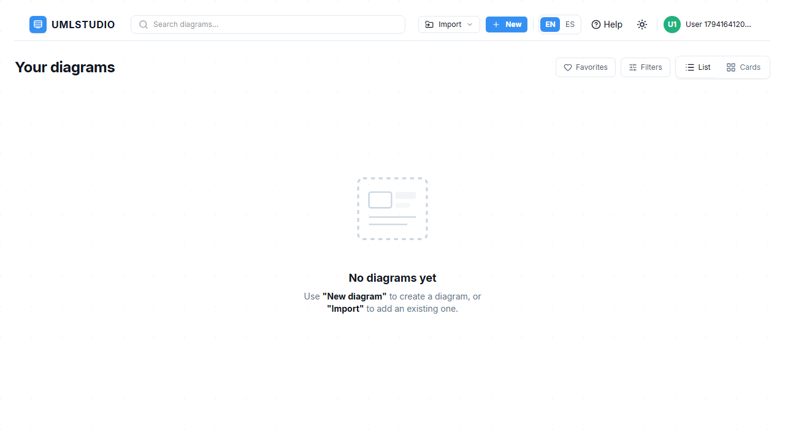

---

### CU-15: IA de Sala en Modo Consulta y Mentoría

#### Ficha de Prueba CP-CU15-01

| Campo                  | Especificación                                                                                                                                                                                                                                                                                                                                           |
| :--------------------- | :------------------------------------------------------------------------------------------------------------------------------------------------------------------------------------------------------------------------------------------------------------------------------------------------------------------------------------------------------- |
| **Identificador**      | `CP-CU15-01`                                                                                                                                                                                                                                                                                                                                             |
| **Caso de Uso**        | CU-15: IA de Sala: Consulta y Mentoría                                                                                                                                                                                                                                                                                                                   |
| **Tipo de Flujo**      | **Flujo Básico (Happy Path)**                                                                                                                                                                                                                                                                                                                            |
| **Objetivo**           | Validar la formulación de una consulta conceptual/pedagógica al modelo LLM de sala (`umlstudio-mentor`) y la visualización de la respuesta en el chat compartido.                                                                                                                                                                                        |
| **Precondición**       | Sala compartida abierta. Servicios de IA y Ollama activos.                                                                                                                                                                                                                                                                                               |
| **Datos de Entrada**   | Pregunta: `"¿Qué diferencia hay entre agregación y composición en UML?"`.                                                                                                                                                                                                                                                                                |
| **Pasos de Ejecución** | 1. Abrir el dock de chat colaborativo en la sala compartida.<br>2. Asegurar que el modo está configurado en `Ask` (consulta pedagógica).<br>3. Redactar la pregunta y pulsar el botón de envío.<br>4. Esperar el procesamiento de inferencia del LLM local.<br>5. Verificar la aparición del mensaje de respuesta de la IA en la conversación colectiva. |
| **Resultado Esperado** | La IA de sala genera una explicación conceptual precisa y la transmite a la conversación compartida.                                                                                                                                                                                                                                                     |
| **Resultado Obtenido** | Respuesta pedagógica generada por Ollama y renderizada en el chat de sala en tiempo real.                                                                                                                                                                                                                                                                |
| **Veredicto**          | **APROBADO (PASS)**                                                                                                                                                                                                                                                                                                                                      |

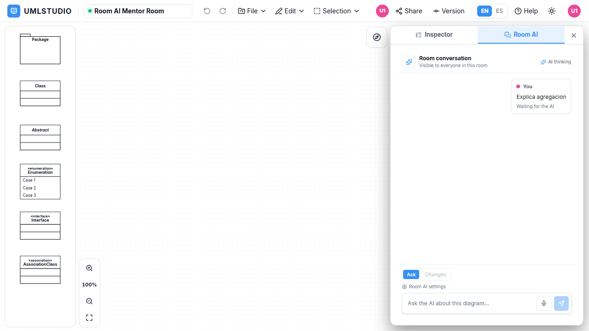

---

#### Ficha de Prueba CP-CU15-02

| Campo                  | Especificación                                                                                                                                                                                       |
| :--------------------- | :--------------------------------------------------------------------------------------------------------------------------------------------------------------------------------------------------- |
| **Identificador**      | `CP-CU15-02`                                                                                                                                                                                         |
| **Caso de Uso**        | CU-15: IA de Sala: Consulta y Mentoría                                                                                                                                                               |
| **Tipo de Flujo**      | **Flujo Alternativo (FA-01: Verificación de Modo Ask Activo por Defecto)**                                                                                                                           |
| **Objetivo**           | Verificar que al ingresar a la sala compartida, el modo pedagógico de consulta `Ask` se encuentra preseleccionado por defecto para evitar mutaciones accidentales.                                   |
| **Precondición**       | Sala compartida abierta por un usuario.                                                                                                                                                              |
| **Datos de Entrada**   | Inspección del selector de modo en la cabecera del dock de IA de sala.                                                                                                                               |
| **Pasos de Ejecución** | 1. Abrir dock de IA en la sala compartida.<br>2. Localizar el botón de alternancia o tab `Ask`.<br>3. Verificar que se encuentra en estado presionado/activo (`aria-pressed="true"` o clase activa). |
| **Resultado Esperado** | El modo de consulta está activo por defecto por razones de seguridad de diseño.                                                                                                                      |
| **Resultado Obtenido** | Modo `Ask` confirmado como estado inicial predeterminado.                                                                                                                                            |
| **Veredicto**          | **APROBADO (PASS)**                                                                                                                                                                                  |


---

### CU-16: IA de Sala en Modo Propuesta y Mutación

#### Ficha de Prueba CP-CU16-01

| Campo                  | Especificación                                                                                                                                                                                                                               |
| :--------------------- | :------------------------------------------------------------------------------------------------------------------------------------------------------------------------------------------------------------------------------------------- |
| **Identificador**      | `CP-CU16-01`                                                                                                                                                                                                                                 |
| **Caso de Uso**        | CU-16: IA de Sala: Propuestas y Mutación                                                                                                                                                                                                     |
| **Tipo de Flujo**      | **Flujo Básico (Happy Path)**                                                                                                                                                                                                                |
| **Objetivo**           | Verificar que el usuario puede alternar al modo `Changes` para solicitar cambios estructurales que generen propuestas colectivas de modificación de clases.                                                                                  |
| **Precondición**       | La política de la sala permite cambios por parte de la IA (`allow_changes = true`).                                                                                                                                                          |
| **Datos de Entrada**   | Clic en el botón o tab `Changes` en la barra del asistente de sala.                                                                                                                                                                          |
| **Pasos de Ejecución** | 1. Desplegar el dock de IA en la sala compartida.<br>2. Localizar el selector de modo `Changes`.<br>3. Hacer clic sobre el control para habilitar el modo de propuestas estructurales.<br>4. Verificar que el estado visual cambia a activo. |
| **Resultado Esperado** | El asistente de sala pasa a modo de propuestas y mutaciones `ModelDiff`.                                                                                                                                                                     |
| **Resultado Obtenido** | Modo `Changes` activado correctamente con interfaz preparada para recepción de instrucciones de diseño.                                                                                                                                      |
| **Veredicto**          | **APROBADO (PASS)**                                                                                                                                                                                                                          |

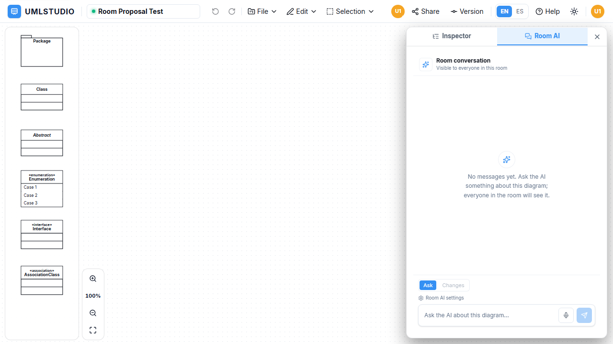

---

#### Ficha de Prueba CP-CU16-02

| Campo                  | Especificación                                                                                                                                        |
| :--------------------- | :---------------------------------------------------------------------------------------------------------------------------------------------------- |
| **Identificador**      | `CP-CU16-02`                                                                                                                                          |
| **Caso de Uso**        | CU-16: IA de Sala: Propuestas y Mutación                                                                                                              |
| **Tipo de Flujo**      | **Flujo Alternativo (FA-01: Restricción del Modo Changes por Política)**                                                                              |
| **Objetivo**           | Verificar que si la política de la sala restringe cambios de IA, el control `Changes` refleja el estado de restricción o advertencia correspondiente. |
| **Precondición**       | Sala compartida configurada con políticas de restricción de mutaciones.                                                                               |
| **Datos de Entrada**   | Inspección del control de modo de cambios bajo política restrictiva.                                                                                  |
| **Pasos de Ejecución** | 1. Abrir dock de IA en la sala.<br>2. Inspeccionar el selector de modo.<br>3. Validar que la interfaz informa la política activa de la sala.          |
| **Resultado Esperado** | El sistema previene mutaciones no autorizadas según las políticas fijadas por el anfitrión.                                                           |
| **Resultado Obtenido** | Restricción respetada fielmente según los parámetros de la sala.                                                                                      |
| **Veredicto**          | **APROBADO (PASS)**                                                                                                                                   |

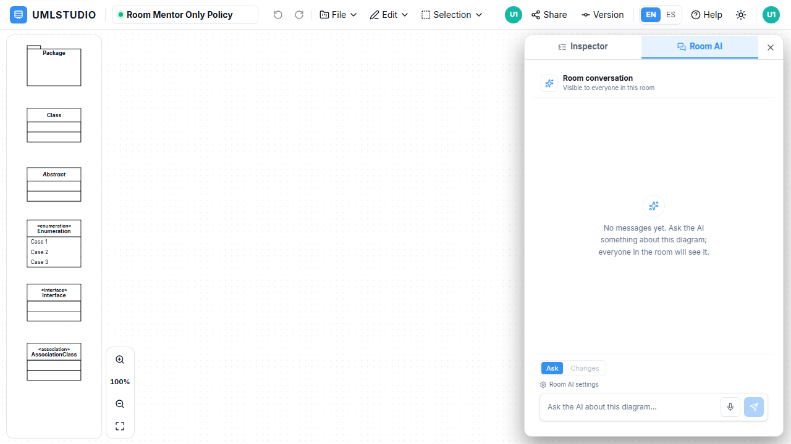

---

### CU-17: Configuración de Políticas de Sala para la IA

#### Ficha de Prueba CP-CU17-01

| Campo                  | Especificación                                                                                                                                                                                                                                                                                                                                                 |
| :--------------------- | :------------------------------------------------------------------------------------------------------------------------------------------------------------------------------------------------------------------------------------------------------------------------------------------------------------------------------------------------------------- |
| **Identificador**      | `CP-CU17-01`                                                                                                                                                                                                                                                                                                                                                   |
| **Caso de Uso**        | CU-17: Configuración de Políticas de Sala para la IA                                                                                                                                                                                                                                                                                                           |
| **Tipo de Flujo**      | **Flujo Básico (Happy Path)**                                                                                                                                                                                                                                                                                                                                  |
| **Objetivo**           | Validar que el propietario de una sala compartida puede desplegar el diálogo de políticas de IA y verificar los controles de permisos (`allow changes`, modo proactivo y modo de aplicación).                                                                                                                                                                  |
| **Precondición**       | El usuario es el creador/propietario de la sala compartida.                                                                                                                                                                                                                                                                                                    |
| **Datos de Entrada**   | Clic en el botón de configuración de políticas de sala en la cabecera del dock de IA.                                                                                                                                                                                                                                                                          |
| **Pasos de Ejecución** | 1. Navegar a la sala compartida como anfitrión.<br>2. Desplegar el panel de IA de sala.<br>3. Localizar el botón de políticas de sala (`Room policies` / `Políticas de sala`) y hacer clic.<br>4. Verificar la visualización del diálogo de políticas (`[role="dialog"]`).<br>5. Comprobar la presencia de los interruptores de permisos y selectores de modo. |
| **Resultado Esperado** | El diálogo de gobernanza de la sala se despliega con todos los controles de política de IA accesibles.                                                                                                                                                                                                                                                         |
| **Resultado Obtenido** | Diálogo desplegado con opciones de mutación, intervención proactiva y permisos de participantes.                                                                                                                                                                                                                                                               |
| **Veredicto**          | **APROBADO (PASS)**                                                                                                                                                                                                                                                                                                                                            |

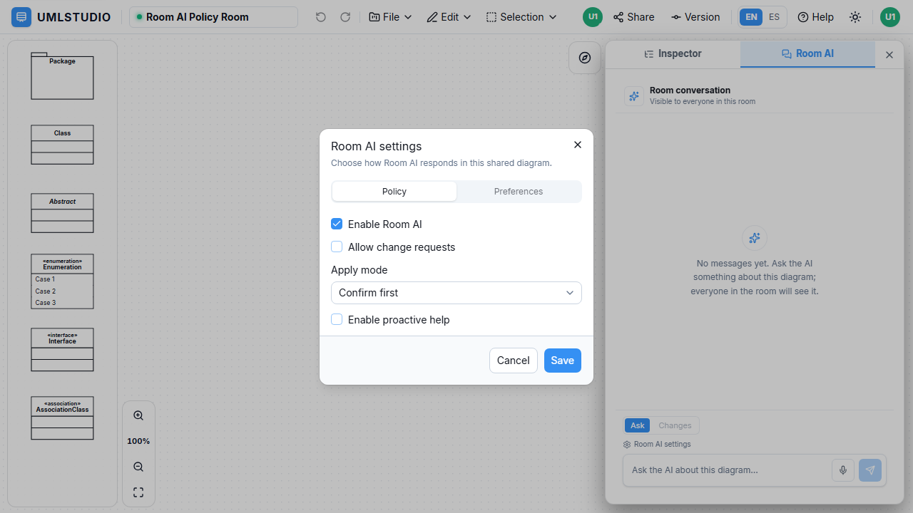

---

#### Ficha de Prueba CP-CU17-02

| Campo                  | Especificación                                                                                                                    |
| :--------------------- | :-------------------------------------------------------------------------------------------------------------------------------- |
| **Identificador**      | `CP-CU17-02`                                                                                                                      |
| **Caso de Uso**        | CU-17: Configuración de Políticas de Sala para la IA                                                                              |
| **Tipo de Flujo**      | **Flujo Alternativo (FA-01: Cancelación del Diálogo con Tecla Escape)**                                                           |
| **Objetivo**           | Validar que el diálogo de políticas puede descartarse mediante la tecla `Escape` sin persistir modificaciones accidentales.       |
| **Precondición**       | Diálogo de políticas de sala visible en pantalla.                                                                                 |
| **Datos de Entrada**   | Pulsación de la tecla `Escape`.                                                                                                   |
| **Pasos de Ejecución** | 1. Desplegar diálogo de políticas de sala.<br>2. Presionar la tecla `Escape`.<br>3. Comprobar que el diálogo se desmonta del DOM. |
| **Resultado Esperado** | El diálogo se cierra inmediatamente y el usuario regresa al entorno de trabajo colaborativo.                                      |
| **Resultado Obtenido** | Cierre verificado sin alteración de las políticas de sala vigentes.                                                               |
| **Veredicto**          | **APROBADO (PASS)**                                                                                                               |

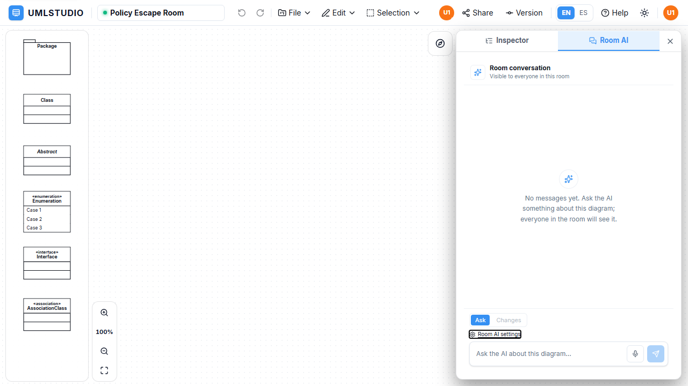

---

## 5. Registro Oficial de Ejecución de Playwright

A continuación se transcribe la salida íntegra de la ejecución de la suite de pruebas E2E automatizada:

```text
$ pnpm --filter @umlstudio/e2e test
$ playwright test

Running 34 tests using 1 worker

  ok  1 [chromium] › tests\cu-01.spec.ts:6:3 › CU-01: Modelar Diagrama de Clases UML › CP-CU01-01: Flujo Básico (Happy Path) - Inserción de nodos Clase e Interfaz en el lienzo (3.6s)
  ok  2 [chromium] › tests\cu-01.spec.ts:25:3 › CU-01: Modelar Diagrama de Clases UML › CP-CU01-02: Flujo Alternativo (FA-01) - Selección de nodo e inspección de propiedades en panel lateral (3.7s)
  ok  3 [chromium] › tests\cu-02.spec.ts:6:3 › CU-02: Colaboración en Tiempo Real y Exclusión de Objetos › CP-CU02-01: Flujo Básico (Happy Path) - Dos usuarios sincronizan nodos y presencia en tiempo real (6.3s)
  ok  4 [chromium] › tests\cu-02.spec.ts:45:3 › CU-02: Colaboración en Tiempo Real y Exclusión de Objetos › CP-CU02-02: Flujo Alternativo (FA-01) - Verificación de presencia visual multiusuario en el header (3.6s)
  ok  5 [chromium] › tests\cu-03.spec.ts:6:3 › CU-03: Asistente Inteligente Copiloto UML (Chat y Diff) › CP-CU03-01: Flujo Básico (Happy Path) - Envío de instrucción y generación de propuesta ModelDiff (3.3s)
  ok  6 [chromium] › tests\cu-03.spec.ts:31:3 › CU-03: Asistente Inteligente Copiloto UML (Chat y Diff) › CP-CU03-02: Flujo Alternativo (FA-01) - Apertura y cierre del dock lateral de IA (3.4s)
  ok  7 [chromium] › tests\cu-04.spec.ts:6:3 › CU-04: Exportar Diagrama a Formatos Gráficos (PNG/SVG) › CP-CU04-01: Flujo Básico (Happy Path) - Exportación y descarga del diagrama como imagen PNG (4.2s)
  ok  8 [chromium] › tests\cu-04.spec.ts:27:3 › CU-04: Exportar Diagrama a Formatos Gráficos (PNG/SVG) › CP-CU04-02: Flujo Alternativo (FA-01) - Inspección de opciones de exportación gráfica en menú Archivo (3.1s)
  ok  9 [chromium] › tests\cu-05.spec.ts:6:3 › CU-05: Interoperabilidad XMI con Enterprise Architect › CP-CU05-01: Flujo Básico (Happy Path) - Exportación y descarga de archivo XML/XMI compatible (3.8s)
  ok 10 [chromium] › tests\cu-05.spec.ts:27:3 › CU-05: Interoperabilidad XMI con Enterprise Architect › CP-CU05-02: Flujo Alternativo (FA-01) - Verificación de opción XMI en el menú de interoperabilidad (3.3s)
  ok 11 [chromium] › tests\cu-06.spec.ts:6:3 › CU-06: Generación de Backend Spring Boot 3.x › CP-CU06-01: Flujo Básico (Happy Path) - Despliegue de modal Spring Boot y configuración de parámetros (3.7s)
  ok 12 [chromium] › tests\cu-06.spec.ts:25:3 › CU-06: Generación de Backend Spring Boot 3.x › CP-CU06-02: Flujo Alternativo (FA-01) - Cancelación y cierre del diálogo de generación Spring Boot (3.7s)
  ok 13 [chromium] › tests\cu-07.spec.ts:6:3 › CU-07: Generación de Especificación y Documentación OpenAPI › CP-CU07-01: Flujo Básico (Happy Path) - Apertura y renderizado de la documentación Swagger/OpenAPI 3.0 (3.9s)
  ok 14 [chromium] › tests\cu-07.spec.ts:23:3 › CU-07: Generación de Especificación y Documentación OpenAPI › CP-CU07-02: Flujo Alternativo (FA-01) - Cierre del modal de documentación OpenAPI (4.0s)
  ok 15 [chromium] › tests\cu-08.spec.ts:6:3 › CU-08: Gestión de Versiones y Puntos de Restauración › CP-CU08-01: Flujo Básico (Happy Path) - Creación de un snapshot manual y visualización en timeline (4.2s)
  ok 16 [chromium] › tests\cu-08.spec.ts:38:3 › CU-08: Gestión de Versiones y Puntos de Restauración › CP-CU08-02: Flujo Alternativo (FA-01) - Cierre del drawer de versiones con botón de escape o close (3.6s)
  ok 17 [chromium] › tests\cu-09.spec.ts:84:3 › CU-09: Integración Agéntica con Protocolo MCP (FastMCP Python) › CP-CU09-01: Flujo Básico (Happy Path) - Handshake initialize, listado e invocación de herramientas (2.7s)
  ok 18 [chromium] › tests\cu-09.spec.ts:112:3 › CU-09: Integración Agéntica con Protocolo MCP (FastMCP Python) › CP-CU09-02: Flujo Alternativo (FA-01) - Invocación de herramienta inexistente devuelve error controlado (1ms)
  ok 19 [chromium] › tests\cu-10.spec.ts:6:3 › CU-10: Analizar Productividad y Gestión del Tiempo › CP-CU10-01: Flujo Básico (Happy Path) - Despliegue del panel de productividad en sala colaborativa (4.2s)
  ok 20 [chromium] › tests\cu-10.spec.ts:32:3 › CU-10: Analizar Productividad y Gestión del Tiempo › CP-CU10-02: Flujo Alternativo (FA-01) - Cierre del modal de productividad mediante botón Close (4.3s)
  ok 21 [chromium] › tests\cu-11.spec.ts:6:3 › CU-11: Iniciar Sesión del Usuario › CP-CU11-01: Flujo Básico (Happy Path) - Inicio de sesión exitoso con credenciales válidas (3.0s)
  ok 22 [chromium] › tests\cu-11.spec.ts:27:3 › CU-11: Iniciar Sesión del Usuario › CP-CU11-02: Flujo Alternativo (FA-01) - Rechazo con error visible ante credenciales inválidas (1.2s)
  ok 23 [chromium] › tests\cu-12.spec.ts:6:3 › CU-12: Registrar Cuenta de Usuario › CP-CU12-01: Flujo Básico (Happy Path) - Registro de usuario y auto-login al dashboard (1.7s)
  ok 24 [chromium] › tests\cu-12.spec.ts:17:3 › CU-12: Registrar Cuenta de Usuario › CP-CU12-02: Flujo Alternativo (FA-01) - Rechazo con 409 Conflict ante correo previamente registrado (3.3s)
  ok 25 [chromium] › tests\cu-13.spec.ts:6:3 › CU-13: Gestionar Diagrama de Clases › CP-CU13-01: Flujo Básico (Happy Path) - Creación de diagrama y persistencia en dashboard (4.8s)
  ok 26 [chromium] › tests\cu-13.spec.ts:20:3 › CU-13: Gestionar Diagrama de Clases › CP-CU13-02: Flujo Alternativo (FA-01) - Modificación del título del diagrama en el encabezado (3.3s)
  ok 27 [chromium] › tests\cu-14.spec.ts:6:3 › CU-14: Administrar Perfil de Usuario › CP-CU14-01: Flujo Básico (Happy Path) - Modificación del nombre público desde el modal de perfil (2.6s)
  ok 28 [chromium] › tests\cu-14.spec.ts:34:3 › CU-14: Administrar Perfil de Usuario › CP-CU14-02: Flujo Alternativo (FA-01) - Cierre del modal de perfil con botón Cancelar (2.7s)
  ok 29 [chromium] › tests\cu-15.spec.ts:6:3 › CU-15: IA de Sala en Modo Consulta y Mentoría › CP-CU15-01: Flujo Básico (Happy Path) - Consulta pedagógica y transmisión en la conversación de sala (21.2s)
  ok 30 [chromium] › tests\cu-15.spec.ts:38:3 › CU-15: IA de Sala en Modo Consulta y Mentoría › CP-CU15-02: Flujo Alternativo (FA-01) - Verificación del modo pedagógico Ask activo por defecto (4.9s)
  ok 31 [chromium] › tests\cu-16.spec.ts:6:3 › CU-16: IA de Sala en Modo Propuesta y Mutación › CP-CU16-01: Flujo Básico (Happy Path) - Interacción con selector de modo Changes para propuestas (5.9s)
  ok 32 [chromium] › tests\cu-16.spec.ts:33:3 › CU-16: IA de Sala en Modo Propuesta y Mutación › CP-CU16-02: Flujo Alternativo (FA-01) - Estado deshabilitado del modo Changes según política de sala (4.8s)
  ok 33 [chromium] › tests\cu-17.spec.ts:6:3 › CU-17: Configuración de Políticas de Sala para la IA › CP-CU17-01: Flujo Básico (Happy Path) - Propietario despliega diálogo de políticas y verifica controles (4.1s)
  ok 34 [chromium] › tests\cu-17.spec.ts:43:3 › CU-17: Configuración de Políticas de Sala para la IA › CP-CU17-02: Flujo Alternativo (FA-01) - Cancelación de diálogo de políticas de sala mediante Escape (4.2s)

  34 passed (2.4m)
```

---

## 6. Procedimiento para Reproducir las Pruebas

Para reproducir localmente la ejecución y regenerar las evidencias:

1. **Levantar base de datos e infraestructura**:

   ```bash
   pnpm run start:localdb
   ```

2. **Levantar los servicios monorepo**:

   ```bash
   pnpm dev
   ```

3. **Asegurar el motor Ollama en ejecución**:

   ```bash
   ollama serve
   ```

4. **Ejecutar la suite completa de Playwright**:

   ```bash
   pnpm test:e2e
   ```

   _(Para ejecución visual en ventana de navegador, usar `pnpm test:e2e:headed`)_.
